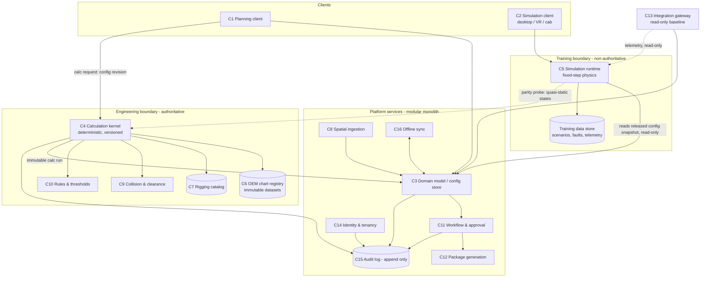
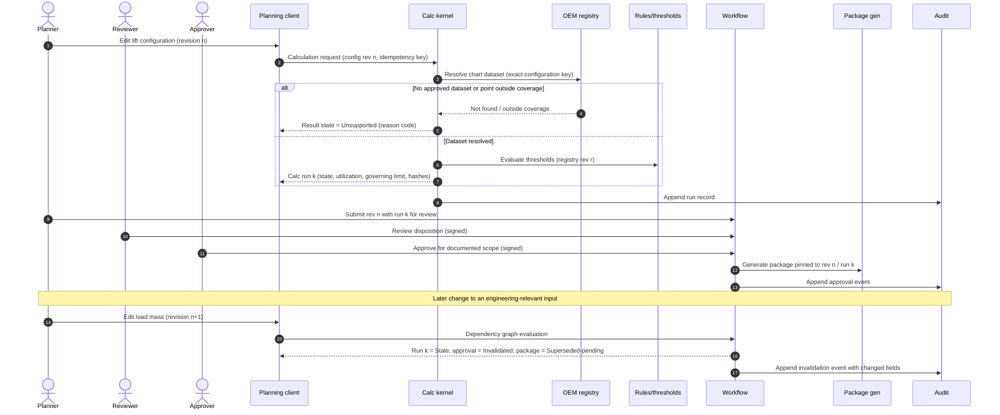
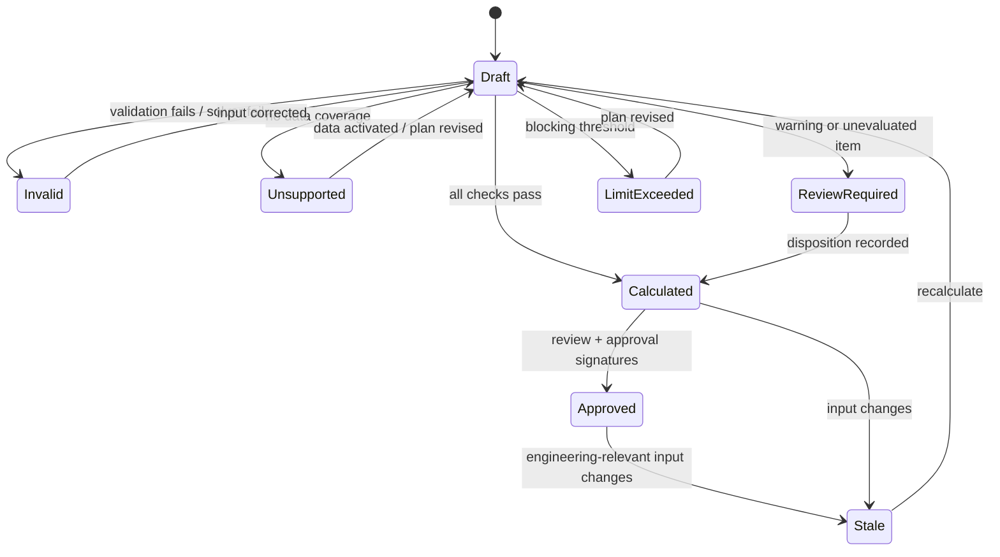

# Enterprise Crane Pick Plan Simulator Functional Requirements & Architecture Specification

| Item | Value |
|---|---|
| Document status | Draft for engineering, architecture and procurement review — **not approved** |
| Revision | 0.1 (2026-11-10) |
| Nature | Proposed product requirements. Nothing in this document is professional engineering certification, regulatory approval, operator qualification, or authorization to perform a lift. |
| Sources reviewed | The master prompt; three OSHA sections fetched from osha.gov on 2026-11-10 (Appendix B); this repository's existing crane-pick calculator source (§1.5). No attachments, OEM data, geotechnical data, or licensed standards text were supplied. |

## How to read this document

**Normative words.** SHALL = mandatory proposed product requirement. SHOULD = recommended. MAY = optional. A SHALL here is a product requirement proposed by this specification, not a legal requirement, unless its Authority cell cites a Verified regulatory source.

**Evidence labels** (used in every Authority cell and register):

| Label | Meaning |
|---|---|
| **[V]** Verified | Supported by an identified authoritative source read during drafting (Appendix B) |
| **[U]** User-supplied | Stated in the request; not independently verified |
| **[A]** Assumption | Working premise pending confirmation (Appendix F) |
| **[R]** Recommendation | Proposed design or requirement originating in this specification |
| **[TBD]** | Open; has an owner role and resolution action |
| **[X]** Unsupported | Outside available data or validated capability |

**Priority / phase.** M = Must, S = Should, C = Could. P1 = recommended initial release (engineering planning core). P2 = spatial, tandem and workflow expansion. P3 = simulation and training. P4 = live telemetry, AR, hardware-in-the-loop. Phases express dependency order only; no dates or costs are implied.

**Requirement tables.** Every module table carries the eleven mandatory fields: ID · Requirement · Pri/Phase · Actor & trigger · Inputs · Processing · Outputs · Authority · Failure behavior · Acceptance criteria · Dependencies. Acceptance criteria reference test IDs in Appendix D (`VT-` numerical, `FT-` failure, `PT-` performance, `IT-` inspection/demonstration).

---

## 1. Executive Summary

### 1.1 Purpose

The platform serves two connected purposes that share one versioned lift configuration:

1. **Engineering lift planning** — configure cranes and rigging, evaluate lift steps against OEM chart data, rigging limits, ground support and clearances, route the plan through review and approval, and issue a traceable lift package.
2. **Operator and rigging simulation** — rehearse the same lift in a real-time 3D environment with a crew, an instructor, and controlled faults.

### 1.2 Governing design positions

| # | Position | Label |
|---|---|---|
| 1 | The **engineering calculation kernel** is the only source of numbers that appear in a lift package. It is deterministic, versioned, and independent of rendering. | [R] |
| 2 | The **simulation runtime** approximates behavior for training. Its outputs are never engineering evidence and cannot change engineering records. | [R] |
| 3 | Rated capacity comes only from an approved, revision-controlled OEM chart dataset for the exact configuration. No generic chart, no extrapolation, no capacity inferred from load moment or a tipping percentage. | [R]; consistent with 29 CFR 1926.1417(a), (o)(1) [V] |
| 4 | Missing, stale, invalid or unsupported safety-relevant input produces a **named non-passing state**, never a zero, a default, or a pass. | [R] |
| 5 | Thresholds live in a registry with authority, applicability and revision. No universal critical-lift percentage, wind limit, tandem derate, sling angle, soil capacity or electrical clearance is hard-coded. | [R] |
| 6 | "Approved" means approved by named people for a documented scope and revision. The software state is a record of that decision, not proof of field safety. | [R] |
| 7 | Baseline machine integration is **read-only**. Machine command/control is a separate scope with its own engineering, security and authorization process. | [R] |

### 1.3 Recommended initial scope

| In initial scope (P1–P2) | Separate scope decision (not silently included) |
|---|---|
| Telescopic mobile cranes: all-terrain, rough-terrain, truck-mounted | Tower cranes |
| Lattice-boom crawler cranes, stationary configuration | Floating / barge-mounted and offshore lifting |
| On-outrigger and stationary-crawler lifts | Personnel hoisting |
| Single-crane lifts (P1); two-crane tandem and tailing (P2) | Assembly/disassembly engineering |
| Pick-and-carry and on-tire lifts: data model present, calculation **Unsupported** until OEM data and method are validated | Machine command/control |
| US rule set first (OSHA 29 CFR 1926 Subpart CC); other jurisdictions as separately versioned rule sets | Derricks, overhead/gantry cranes, articulating/knuckle-boom cranes |

Rationale [R]: the listed crane families share a chart-lookup structure (configuration → boom length × radius table), which bounds the P1 data model. Crawler superlift/derrick-attachment configurations are P2 because their charts add counterweight-radius dimensions.

### 1.4 What is decided, assumed and open

- **Specified:** 153 requirements across 15 ID families, schemas, threshold registry structure, validation matrix, risk register, procurement matrix.
- **Independently recalculated during drafting:** the analytical benchmarks in Appendix D.2 (arithmetic only; they do not validate any crane model).
- **Executed tests:** none. No software described here exists; every test in Appendix D is proposed.
- **Awaiting external data or approval:** OEM chart licensing and format, OEM outrigger-reaction and deflection data, jurisdiction, licensed standards text and editions, geotechnical input standards, deployment model, simulator hardware.

### 1.5 Relationship to the existing SteelBuild Pro crane-pick calculator

The request states that no existing implementation was supplied. Repository inspection [V] shows a narrow precursor that this specification neither replaces nor certifies:

| Existing module | What it does | Position relative to this specification |
|---|---|---|
| `src/lib/crane/loadChart.ts` | Owner-entered chart lookup; never extrapolates; takes the lower bracketing cell; blank cell = not rated; lattice booms only at listed lengths | Its refusal rules are consistent with ENG-004…ENG-008. It holds no OEM data and has no dataset governance (ENG-001…ENG-003). |
| `src/utils/cranePickMath.ts`, `src/utils/riggingCalculations.js` | Gross load for chart, sling tension, two-leg offset-CG bridle, WLL utilization | Candidate reference implementations for RIG benchmark tests; not a rigging solver. |
| `src/lib/crane/groundBearing.ts` | Average pressure = (reaction + mat weight) / mat area; reaction and allowable bearing are user inputs | Matches the limited applicability stated in GND-004. No reaction solver. |
| `src/components/calculators/CranePick3D.tsx` | Illustrative 3D view | Visualization only; not collision analysis. |

Whether this specification is built inside SteelBuild Pro, alongside it, or procured externally is an owner decision (Appendix F, D-01).

### 1.6 Acceptance checklist — Executive Summary

- [ ] Initial scope and each exclusion is accepted or amended by the owner (D-02).
- [ ] The seven design positions are accepted by engineering and architecture leads.
- [ ] Jurisdiction (D-03) and deployment model (D-04) are decided or explicitly deferred.

---

## 2. System Architecture

### 2.1 Logical components

| # | Component | Responsibility | Authoritative for engineering output? |
|---|---|---|---|
| C1 | Engineering planning client | Author configurations, lift steps, rigging; view results; assemble packages | No — displays kernel results |
| C2 | Simulation client (desktop / VR / cab) | Render and control training sessions | No |
| C3 | Shared domain model | Versioned schemas (Appendix A) used by every component | Defines the data, not results |
| C4 | Engineering calculation kernel | Chart lookup, deductions, kinematics, rigging statics, reactions, wind force, clearance metrics | **Yes — sole authority** |
| C5 | Real-time simulation runtime | Multibody dynamics, control response, fault injection | No |
| C6 | OEM configuration & chart registry | Immutable approved datasets, review records, regression baselines | Authoritative data source for C4 |
| C7 | Rigging & equipment catalog | Component ratings, inspection status, manufacturer restrictions | Authoritative data source for C4 |
| C8 | Spatial ingestion & geometry services | Import, transform, tile, attribute retention, provenance | Authoritative for geometry provenance |
| C9 | Collision & clearance analysis | Continuous swept-volume checks, minimum-distance queries | **Yes** (invoked by C4 with pinned tolerance settings) |
| C10 | Rules & threshold service | Threshold registry, jurisdiction rule sets, result-state evaluation | **Yes** for state evaluation |
| C11 | Workflow, review & approval | States, signatures, invalidation, deviations | Authoritative for approval records |
| C12 | Document / CAD package generation | PDF/A, DXF, IFC/BCF, CSV, JSON from a pinned calculation run | No — renders C4/C11 records |
| C13 | Integration gateway | Files, APIs, telemetry ingestion, read-only monitoring | No |
| C14 | Identity, permissions, tenant isolation | Federation, RBAC/ABAC, tenant boundary | Authoritative for access |
| C15 | Audit, monitoring, operations | Append-only audit, metrics, alerting, backup | Authoritative for audit trail |
| C16 | Offline sync & conflict resolution | Signed offline packages, controlled resynchronization | No — cannot supersede C11 |

### 2.2 Architecture diagram



### 2.3 Calculation authority

| Question | Answer |
|---|---|
| Which calculations are authoritative? | Only C4 (with C9, C10) operating on approved C6/C7 data. Each run is stored immutably with kernel version, dataset revisions, threshold-registry revision, input hash and output hash. |
| Which calculations approximate for training? | Everything in C5: pendulation, control/hydraulic response, contact, fault effects, rendered deflection. |
| How do both consume the same configuration? | C5 loads a **read-only snapshot** of a specific lift-configuration revision from C3. Training-side modifications (faults, altered weights, fictional sites) are stored as an overlay in the training store keyed to that snapshot; they are never written back. |
| How is planning/simulation disagreement detected? | **Parity probe** (ARCH-006): at each defined hold point and at user-selected quasi-static states, C5 submits its settled state (radius, hook load, slew, boom length) to C4 and compares radius, utilization and governing limit against tolerance bands in the threshold registry. |
| How is disagreement resolved? | The engineering result always stands. The session is flagged "simulation out of parity", the affected training score segment is marked non-representative, and a defect record is opened against the equipment profile. A simulation result can never amend a plan. |
| How do revisions invalidate results? | Every calc run records the content hash of each input entity. A dependency graph (WF-006) marks runs and approvals **Stale** when any hashed input changes; engineering-relevant fields are enumerated per entity in Appendix A. |
| Why are results reproducible despite frame rate? | C4 has no time loop tied to rendering; it evaluates discrete lift steps and sampled trajectories at a sample spacing fixed in the run request. C5 integrates physics on a fixed timestep decoupled from rendering (SIM-002); rendering interpolates between physics states. Collision checks are continuous over motion intervals, not per rendered frame (SPAT-010). |

### 2.4 Sequence — calculation, review, approval, invalidation



### 2.5 Architecture alternatives

| Criterion | A. Full microservices | **B. Modular monolith + isolated calc kernel + separate sim runtime (recommended)** | C. Desktop-first thick client with sync server |
|---|---|---|---|
| Numerical reliability | Kernel isolated; version skew across services is a risk | Kernel is one pinned, independently tested artifact used by server and offline client | Kernel embedded per install; version control across field machines is harder |
| Disconnected operation | Poor without a second offline stack | Good: same kernel artifact ships in the signed offline package | Best |
| Deployment complexity | Highest; hard to deliver on-premises | Moderate; single deployable plus kernel and sim | Low server, high endpoint management |
| OEM data licensing | Central control | Central control; offline packages carry only licensed subsets with expiry | Data distributed to endpoints — weakest control |
| Maintainability | Many contracts to version | Module boundaries enforced in one codebase; split later where load demands | Platform-specific clients |
| Performance | Scales pieces independently | Spatial tiling and package generation can be split out when benchmarks require | Bounded by workstation |

**Recommended baseline [R]: B.** Material tradeoffs: horizontal scaling of spatial ingestion may later force extraction of C8; the kernel must be built to run identically on server and field hardware, which constrains language/runtime choice and requires bit-reproducibility tests (VAL-003). Microservices are not assumed for any component; C8 and C12 are the only candidates for extraction, on benchmark evidence.

### 2.6 Deployment boundaries

| Mode | Contents | Constraints |
|---|---|---|
| Cloud (multi-tenant) | All components; tenant isolation per SEC-002 | Data-residency region selectable per tenant; OEM license terms may forbid (R-02) |
| Private cloud / on-premises | Same deployable, single tenant | Customer operates identity federation and backup; update cadence contractual |
| Disconnected field | C1 read/markup, C4 kernel, pinned datasets, pinned geometry tiles, C2/C5 optional | Signed, expiring offline package; approvals cannot be created offline unless D-07 decides otherwise |

### 2.7 Architecture requirements

| ID | Requirement | Pri/Phase | Actor & trigger | Inputs | Processing | Outputs | Authority | Failure behavior | Acceptance criteria | Dependencies |
|---|---|---|---|---|---|---|---|---|---|---|
| ARCH-001 | The calculation kernel SHALL be a separately versioned artifact with no dependency on rendering, simulation, or UI code. | M/P1 | Build pipeline, each release | Kernel source, dependency manifest | Static dependency check | Kernel artifact + semantic version + build hash | [R] | Build fails on forbidden dependency | IT-01: dependency report shows no render/sim/UI imports | — |
| ARCH-002 | Every calculation run SHALL be stored immutably with kernel version, dataset revisions, threshold-registry revision, unit/gravity convention, input hash and output hash. | M/P1 | C4, on every run | Calc request | Canonical serialization → SHA-256 | Run record | [R] | Run not persisted → result not shown as calculated | FT-14, VT-30: re-run of stored inputs on stored kernel version reproduces output hash | C15 |
| ARCH-003 | Identical inputs on the same kernel version SHALL produce identical numerical outputs on all supported platforms. | M/P1 | Release qualification | Golden input corpus | Run on each supported OS/CPU profile | Output hash set | [R] | Any hash difference blocks release | VT-30: zero hash differences across the declared platform list | Declared platform list [TBD] |
| ARCH-004 | The simulation runtime SHALL access engineering configuration only as a read-only snapshot and SHALL have no write credential to C3, C6, C7, C10 or C11 production stores. | M/P3 | C5 session start | Config revision ID | Snapshot export | Session-local copy | [R] | Missing snapshot → session cannot start in "plan rehearsal" mode | FT-04: write attempts from C5 identity are denied and audited | C14 |
| ARCH-005 | Training overlays (faults, altered masses, fictional sites) SHALL be stored only in the training store and SHALL be labeled as training data wherever displayed or exported. | M/P3 | Instructor, scenario authoring | Overlay definition | Namespace separation | Overlay record | [R] | Attempt to export overlay into an engineering package is rejected | FT-04, IT-02: watermark present on every training export | — |
| ARCH-006 | At each hold point of a plan-rehearsal session the system SHALL run a parity probe comparing simulation quasi-static state against the kernel and SHALL flag out-of-tolerance disagreement. | S/P3 | C5, at hold points | Settled sim state | Kernel evaluation of same state; compare with tolerance from registry | Parity record; flag | [R] | Kernel unavailable → segment marked "parity not evaluated", never "in parity" | VT-28: injected 2 % radius bias is detected; probe result recorded | Tolerances [TBD] in Appendix C |
| ARCH-007 | A change to any engineering-relevant field SHALL mark dependent runs Stale and dependent approvals Invalidated before the changed revision can be submitted. | M/P1 | Any author, on save | Changed entity + field | Dependency graph traversal | State transitions + audit events | [R] | Graph evaluation error → dependent items conservatively marked Stale | FT-09, VT-29 | WF-006 |
| ARCH-008 | The same kernel artifact version used to produce an approved run SHALL be the version shipped in any offline package containing that run. | M/P2 | C16, package build | Run record | Version pin | Signed package manifest | [R] | Version mismatch → package build fails | IT-03 | — |

### 2.8 Acceptance checklist — System Architecture

- [ ] Each of the 16 components has an owner and a deployment unit assignment.
- [ ] ARCH-001…008 each have passing evidence (Appendix D).
- [ ] Alternative B is accepted, or a different alternative is selected with the tradeoffs recorded (D-05).
- [ ] Supported platform list for bit-reproducibility is declared.

---

## 3. Core Physics & Engineering Engine

### 3.1 Conventions

| Topic | Convention | Label |
|---|---|---|
| Internal units | SI: length m, mass kg, force N, pressure Pa, angle rad, time s (UTC timestamps), temperature K | [R] |
| Mass vs force | Stored in separate typed fields; a mass is never stored in a force field or the reverse. Chart capacities are stored in the OEM's published quantity and unit, with a declared type (`mass` or `force`), then converted. | [R] |
| Tons | `t` = metric tonne = 1000 kg exactly. `ton_us` = US short ton = 907.18474 kg exactly. `ton_uk` (long ton) = 1016.0469088 kg, import only. A bare "ton" on import is rejected. | [V] definitional; rejection rule [R] |
| Gravity | Each run records `g`. Default standard gravity 9.80665 m/s² [V definitional]; a site value MAY be set by an engineer and is then recorded in the run. | [R] |
| Display | Controlled SI / US customary display; conversion at the boundary only; rounding rules per quantity in the threshold registry; displayed capacity is never rounded up. | [R] |
| Sling angle | Measured **from horizontal** to the sling leg, internally. Imports and displays stating angle from vertical must be labeled and converted. | [R] |
| Frames | Right-handed. `W` site/world (per site CRS), `C` carrier (origin at slew axis on ground plane, +x carrier front, +z up), `S` superstructure (rotates about z by slew angle), `B` boom (origin boom heel pin), `T` boom/jib tip sheave, `H` hook, `R` rigging apex, `L` load (origin at load datum, CG given in `L`). | [R] |
| Operating radius | Horizontal distance from the slew axis to the vertical line through the hook **under load**, i.e. including deflection where modeled. | [R]; consistent with common OEM chart definition — verify per OEM [TBD] |

### 3.2 OEM load charts and crane configuration (ENG)

Configuration key (all fields required unless the dataset declares a field not applicable): manufacturer; model; serial applicability range; dataset revision; boom system, length and telescoping sequence/pinning code; attachments; jib length, offset, erected/stowed state; counterweight; superlift/derrick configuration; outrigger extension per beam and support arrangement; crawler track extension; slew sector (360°, over-front, over-side, over-rear, or OEM-defined sector); base condition (on outriggers, on tires stationary, stationary crawler, pick-and-carry); reeving and parts of line; hook block; auxiliary head; line-pull limit; chart deductions; configuration-specific restrictions and governing notes.

| ID | Requirement | Pri/Phase | Actor & trigger | Inputs | Processing | Outputs | Authority | Failure behavior | Acceptance criteria | Dependencies |
|---|---|---|---|---|---|---|---|---|---|---|
| ENG-001 | Chart datasets SHALL be accepted only with a recorded license/authorization reference, source document identifiers and source revision. | M/P1 | Data steward, dataset import | Dataset file, license ref, source doc IDs | Mandatory-field validation | Dataset in state `Imported-unreviewed` | [R] | Missing license/source → import rejected | FT-01a: import without license ref is refused | OEM agreement (R-01) |
| ENG-002 | Each dataset SHALL be independently reviewed against the source by a second person before activation; reviewer ≠ importer. | M/P1 | Reviewer | Dataset, source document | Cell-by-cell or sampled verification per approved sampling plan; notes verification 100 % | Review record, discrepancies | [R] | Unreviewed dataset is unusable by C4 | IT-04: activation blocked when reviewer = importer or review missing | Sampling plan [TBD] |
| ENG-003 | Approved datasets SHALL be immutable; a correction creates a new revision. A regression suite SHALL run before a new revision is activated and SHALL list every lookup whose result changes. | M/P1 | Data steward, activation | New revision, golden lookups | Diff of all golden + all historically used lookups | Regression report | [R] | Unexplained change blocks activation | VT-03, FT-15: historic package re-run still resolves the old revision | ARCH-002 |
| ENG-004 | The kernel SHALL resolve a chart only by exact match of the full configuration key and SHALL reject incompatible combinations declared by the dataset. | M/P1 | C4, each run | Configuration | Key match + compatibility rules from dataset | Chart reference or refusal | OEM data; 1926.1417(a) [V] | No match → `Unsupported: no applicable chart`; never a nearest or generic chart | VT-01, FT-01 | ENG-001 |
| ENG-005 | Lookup between tabulated points SHALL use only the rule the OEM source states for that chart. Where the source states no rule, the kernel SHALL return the lowest capacity of the bracketing entries and label the result `conservative-bracket`. | M/P1 | C4 | Boom length, radius, chart | Dataset-declared rule: `exact-only`, `next-longer-radius`, `next-longer-boom`, `linear-permitted`, etc. | Capacity + rule used | OEM notes [TBD per OEM]; fallback [R] | Rule undeclared and bracket contains blank → `Unsupported` | VT-02 (boundary, between-entry) | — |
| ENG-006 | The kernel SHALL NOT extrapolate beyond chart coverage in any dimension. | M/P1 | C4 | Query point | Coverage test incl. irregular boundaries | Refusal with dimension exceeded | [R] | `Unsupported: outside chart coverage` | VT-02, FT-01 | — |
| ENG-007 | Blank or prohibited cells SHALL be stored as `not-rated`, distinct from zero and from missing data, and any bracket touching one SHALL be refused. | M/P1 | C4 | Chart | Tri-state cell type | Refusal | [R] | `Unsupported: not rated at this position` | VT-02 | — |
| ENG-008 | Lattice booms and pinned telescopic sequences SHALL be evaluated only at lengths/sequences listed in the dataset. | M/P1 | C4 | Boom type, length | Membership test | Refusal or cell | [R] | `Unsupported: unlisted boom length` | VT-02 | — |
| ENG-009 | Slew-sector charts SHALL be evaluated over the entire slew range of each lift step, including transitions; the governing (lowest) sector capacity SHALL be reported with the sector identified. | M/P1 | C4 | Slew start/end per step, sector definitions | Sweep; sector boundary inclusive on the lower-capacity side | Governing sector + capacity | OEM data | Sector geometry undefined → `Unsupported` | VT-04 | — |
| ENG-010 | Gross/net convention SHALL be read from the dataset. The kernel SHALL build an itemized deduction ledger (hook block, auxiliary head, stowed/erected jib, load line beyond OEM allowance, rigging, below-the-hook devices, other suspended items) with each item applied exactly once. | M/P1 | C4 | Dataset convention, suspended items | Ledger with item IDs; duplicate and omission checks against configuration | Chart capacity, deductions, net available, demand | OEM data; B30.5 [TBD edition] | Configured suspended item with no mass → `Invalid input`; duplicate → `Invalid input` | VT-05, FT-02 | C7 |
| ENG-011 | Every result SHALL report: configuration key, loaded operating radius, chart capacity, each deduction, demand, utilization, governing limitation (chart, line pull, sector, structural note, etc.), lookup rule, and uncertainty treatment. | M/P1 | C4 | Run | Assembly | Result record | [R] | Any element unavailable → result state not `Calculated within limits` | IT-05 | — |
| ENG-012 | Line-pull and reeving limits SHALL be checked independently of chart capacity; the lower governs. | M/P1 | C4 | Parts of line, single-line pull, block rating | Min of limits | Governing limit | OEM data | Missing single-line pull → `Invalid input` | VT-06 | — |
| ENG-013 | Capacity SHALL NOT be derived from load moment, a tipping percentage, or any generic formula in place of the OEM chart. | M/P1 | C4 | — | No such code path exists | — | [R]; 1926.1417(o)(1) [V] | n/a | IT-06: code inspection + FT-01 | — |
| ENG-014 | Pick-and-carry and on-tire lifts SHALL return `Unsupported` until an OEM dataset for that condition and a validated method are activated. | M/P1 | C4 | Base condition | Capability flag | Refusal | [R]; 1926.1417(u) [V] relevant to travel with load | `Unsupported` | FT-01 | Scope D-02 |
| ENG-015 | Demand SHALL carry the load-weight evidence type (weighed, manufacturer-stated, calculated from dimensions, estimated) and its declared uncertainty; an `estimated` weight SHALL trigger review state. | M/P1 | Planner | Mass, source, uncertainty | Upper-bound demand = mass × (1 + uncertainty) unless engineer overrides with recorded basis | Demand + basis | [R]; weight-source concept per 1926.1417(o)(3)(i) [V] | Missing weight → `Draft/incomplete` | VT-07, FT-03 | — |

**Acceptance checklist — ENG**
- [ ] Normal: exact-entry lookup matches the dataset value exactly (VT-01).
- [ ] Boundary: last column/row, sector edge, between-entry lookup (VT-02, VT-04).
- [ ] Failure: unavailable chart, blank cell, unlisted lattice length, duplicate deduction (FT-01, FT-02).
- [ ] Only synthetic, clearly labeled charts are used in tests; no real OEM values are embedded in the test corpus without license.

### 3.3 Kinematics, structural response and dynamics (KIN)

Model tiers — a result always states which tier produced it:

| Tier | Purpose | Method | Timestep / convergence | Validation domain | Engineering use |
|---|---|---|---|---|---|
| K0 Rigid-body visualization | Display | Forward kinematics, rigid links | n/a | Geometry only | None |
| K1 Quasi-static engineering | Radius, hook height, headroom, clearances, reactions | Closed-form/iterative statics; equilibrium residual < tolerance | Iterate to force residual ≤ 1e-6 × load [R] | All P1 configurations | **Yes** |
| K2 Flexible-body approximation | Loaded radius growth, tip deflection, rope stretch | OEM deflection tables if supplied; else approved beam/rope model `δ_rope = F·L/(E·A_metallic)` with OEM rope data | Table lookup or converged nonlinear solve | Only configurations with OEM or engineer-approved reference data | Yes, when reference-validated; otherwise `Unsupported` and radius allowance must be entered by an engineer |
| K3 Real-time multibody (training) | Pendulation, control response, faults | Fixed-step integrator (SIM-002) | Fixed step; convergence shown by VT-20 | Per equipment profile | **No** |
| K4 Higher-fidelity external analysis | FEA, coupled dynamics, vessel motion | External tool; results imported as engineer-attested inputs | External | External | Imported with provenance only |

| ID | Requirement | Pri/Phase | Actor & trigger | Inputs | Processing | Outputs | Authority | Failure behavior | Acceptance criteria | Dependencies |
|---|---|---|---|---|---|---|---|---|---|---|
| KIN-001 | The kernel SHALL compute boom-tip, hook, rigging-apex and load positions from slew, boom elevation, telescope, jib offset and hoist length using the frames in §3.1. | M/P1 | C4 | Joint values, geometry from dataset | Homogeneous transforms | Positions in `C` and `W` | [R] | Geometry field missing → `Invalid input` | VT-08: positions agree with hand calculation within 1 mm | Crane geometry data |
| KIN-002 | Loaded operating radius SHALL include deflection from tier K2 where validated; where not, the result SHALL state "deflection not modeled" and require an engineer-entered radius allowance before leaving Draft. | M/P1 | C4 / engineer | K2 data or allowance | Add deflection or allowance | Loaded radius + basis | [R] | No K2 data and no allowance → `Draft/incomplete` | VT-09 against approved reference; FT-03 | OEM deflection data (R-03) |
| KIN-003 | Headroom SHALL be computed from tip height, minimum block-to-tip distance (anti-two-block), block and rigging heights, and load height, including rope stretch where modeled. | M/P1 | C4 | Geometry, rigging assembly | Sum of vertical stack | Headroom margin | [R] | Negative margin → `Limit exceeded` | VT-10 | — |
| KIN-004 | Dynamic amplification SHALL be applied only from a registry entry stating its source and applicability, and the kernel SHALL refuse to apply a dynamic factor to a quantity whose OEM capacity basis or validated model is flagged as already including it. | M/P1 | C4 | Factor registry, dataset flag `dynamic_included` | Single-application guard | Factor ledger | [R] | Flag undeclared → factor decision goes to `Review required` | VT-11, FT-05 | Appendix C |
| KIN-005 | Side loading, dragging, snagging and shock loading SHALL be represented in engineering mode only as prohibited-condition checks (e.g. hook not plumb over CG beyond tolerance at pick), not as quantified allowable loads. | M/P1 | C4 | Hook and CG plan position | Offset check | Warning/limit | [R] | — | VT-12 | Tolerance [TBD] |
| KIN-006 | Training-mode pendulation, load rotation and damping SHALL use tier K3 and SHALL display "training approximation" on any numeric readout not sourced from the kernel. | M/P3 | C5 | Session | Labeling | UI label | [R] | — | IT-07 | — |
| KIN-007 | Hydraulic/control response in training SHALL be parameterized by an equipment profile with a stated validation basis (OEM data, measured machine data, or "generic — not validated"). | S/P3 | Sim engineer | Profile | — | Profile record | [R] | Generic profile shown as such to trainee and instructor | IT-08 | R-08 |
| KIN-008 | Ground/support compliance SHALL be excluded from K1 radius unless an engineer supplies settlement values; the exclusion SHALL be stated on the result. | S/P2 | C4 | Settlement input | Geometric tilt → radius change | Radius delta | [R] | Not supplied → statement of exclusion | VT-13 | Geotech input |
| KIN-009 | Numerical instability (non-convergence, NaN/Inf, energy growth beyond bound in K3) SHALL be detected and reported; the affected result SHALL be `Invalid`, never a number. | M/P1 | C4, C5 | Solver state | Residual, finite-ness and energy monitors | Error record | [R] | `Invalid: solver did not converge` | FT-12 | — |

**Phenomena not credibly simulated without additional data [X]:** boom structural failure modes; hydraulic system transients without OEM valve/pump data; rope spooling and sheave friction beyond simple efficiency factors; soil–structure interaction under a mat; aerodynamic behavior of irregular loads (vortex shedding, lift); ice accretion; snag release dynamics. Training scenarios may dramatize these only when labeled non-validated (SIM-009).

**Acceptance checklist — KIN**
- [ ] Normal: kinematic positions (VT-08), headroom (VT-10).
- [ ] Boundary: minimum/maximum boom angle from dataset; zero headroom.
- [ ] Failure: non-convergence (FT-12); double dynamic factor (FT-05); absent deflection data (FT-03).

### 3.4 Rigging and sling mechanics (RIG)

| ID | Requirement | Pri/Phase | Actor & trigger | Inputs | Processing | Outputs | Authority | Failure behavior | Acceptance criteria | Dependencies |
|---|---|---|---|---|---|---|---|---|---|---|
| RIG-001 | The rigging model SHALL represent an assembly as a graph of components (slings, shackles, hooks, master links, beams, spreaders, adjusters) with connection points and hitch type (vertical, basket, choker) per sling. | M/P1 | Planner | Catalog items, geometry | Graph validation (connected, no orphan) | Assembly | [R] | Disconnected graph → `Invalid input` | IT-09 | C7 |
| RIG-002 | Leg forces SHALL be solved from 3D geometry and CG position. Statically determinate arrangements use equilibrium; indeterminate arrangements (e.g. four legs to a rigid load) SHALL NOT assume equal sharing. | M/P1 | C4 | Lift points, apex, CG, leg stiffness (EA/L) | Determinacy test → equilibrium, or stiffness/compatibility solve with tension-only legs | Per-leg force, slack legs | [R]; B30.9 [TBD edition] | Stiffness data missing for an indeterminate case → solve the governing application rule set by a registry entry (e.g. "n legs carry") with its authority, else `Review required` | VT-14, VT-15, VT-16 | Registry entry [TBD] |
| RIG-003 | The solver SHALL detect slack legs, loss of contact and load rotation to equilibrium, and SHALL report the settled orientation. | M/P2 | C4 | As RIG-002 | Tension-only iteration; rigid-body rotation until CG is under apex | Tilt angles, slack flags | [R] | Non-convergence → `Invalid` | VT-16 | — |
| RIG-004 | Each component's utilization SHALL be computed against its Working Load Limit for the actual hitch, angle and configuration as rated by its manufacturer/catalog entry. Breaking strength SHALL NOT be used to derive an allowable, and no universal design factor SHALL be applied by the software. | M/P1 | C4 | WLL table by hitch/angle, reductions | Lookup; no invented factor | Utilization per component | Manufacturer data; B30.9/B30.26 [TBD edition] | Rating absent for the hitch/angle → `Unsupported` | VT-17, FT-06 | C7 |
| RIG-005 | Restrictions SHALL be evaluated where data exists: choker angle reduction, D/d and bend radius, minimum sling angle, shackle side loading, edge protection required, temperature and chemical exposure limits. | M/P2 | C4 | Component restrictions, environment | Rule evaluation | Findings | Manufacturer data [TBD] | Restriction data missing → finding "not evaluated — data unavailable", never "OK" | VT-18, FT-06 | — |
| RIG-006 | Components SHALL carry identification, inspection status and expiry; an expired or failed inspection status SHALL block release of a plan naming that serialized component. | M/P2 | C4 / C11 | Inspection record | Date/state check at release | Block | [R] | Unknown inspection status → `Review required` | FT-06 | Asset integration INT-003 |
| RIG-007 | Lift-point and below-the-hook structural adequacy SHALL be a distinct verification item with its own evidence reference and attesting engineer; the software SHALL NOT infer adequacy from rigging forces. | M/P1 | Engineer | Evidence document ref | Presence + attestation check | Verification record | [R]; BTH-1/B30.20 interface [TBD edition] | Absent → plan cannot leave `Review required` | FT-07 | — |
| RIG-008 | Upending, tailing and rotation SHALL be analyzed as a sequence of quasi-static states at a declared angular increment, reporting the maximum force per component across the sequence. | M/P2 | C4 | Rotation path, increment | Stepwise statics | Force envelope | [R] | Increment too coarse (force change between steps > registry limit) → refine or `Review required` | VT-19 | TAN module |
| RIG-009 | The system SHALL output a rigging bill of materials with component IDs, ratings, computed forces, utilization, governing restriction and unresolved assumptions. | M/P1 | C12 | Run | Assembly | BOM (PDF, CSV, JSON) | [R] | — | IT-10 | — |

**Acceptance checklist — RIG**
- [ ] Normal: symmetric two-leg benchmark 57.735 kN (VT-14).
- [ ] Boundary: asymmetric two-leg 73.205 / 51.764 kN (VT-15); minimum sling angle from registry.
- [ ] Failure: four-leg rigid load does not return 25 % per leg by default (VT-16); missing WLL for hitch (FT-06).

### 3.5 Ground reactions, bearing pressure and mats (GND)

| ID | Requirement | Pri/Phase | Actor & trigger | Inputs | Processing | Outputs | Authority | Failure behavior | Acceptance criteria | Dependencies |
|---|---|---|---|---|---|---|---|---|---|---|
| GND-001 | Outrigger/support reactions SHALL be taken from OEM reaction data or an OEM calculation method for the configuration and slew position. Where the OEM supplies none, reactions SHALL be `Unsupported` unless an engineer imports attested values. | M/P1 | C4 | OEM reaction tables/method; slew range | Lookup/evaluate across the slew range of each step; report maximum per support | Reaction per support + governing slew angle | OEM data (R-03) | `Unsupported: no reaction data` | VT-21 (synthetic table), FT-08 | OEM data |
| GND-002 | The software SHALL NOT divide crane weight equally among supports and SHALL NOT present a rigid-body equilibrium solution for four or more supports as unique. Any in-house solver SHALL declare its compatibility assumption (rigid carrier on elastic supports, stated stiffness) and be labeled "engineer-approved method" with reference. | M/P1 | C4 | Method declaration | Indeterminacy check | Method label on result | [R] | Undeclared method → no reaction output | IT-11, FT-08 | — |
| GND-003 | Crawler track pressures SHALL come from OEM track-pressure data/method, reported as the distribution shape (trapezoidal/triangular, effective length) the source defines. | M/P2 | C4 | OEM data | Lookup | Peak, min, effective bearing length per track | OEM data | `Unsupported` if absent | VT-22 | OEM data |
| GND-004 | Average contact pressure SHALL be computed as `p = (R + W_mat) / A_eff` only when the mat is declared to distribute load over `A_eff` by an engineer-approved basis; the output SHALL be labeled "average" and SHALL state that it does not establish peak pressure, settlement, mat adequacy or geotechnical capacity. | M/P1 | C4 | Reaction, mat weight, effective area + basis | Division | Average pressure | [R] | `A_eff` basis absent → output labeled "full-footprint assumption — unverified" and state `Review required` | VT-23 (600 kN / 4 m² = 150 kPa) | — |
| GND-005 | Mat structural checks (bending, shear, punching, bearing under the float) SHALL be evaluated only with mat material properties and an approved method; otherwise reported "not evaluated". | S/P2 | C4 | Mat properties, method ref | Method evaluation | Utilizations | [R] | "Not evaluated" blocks release unless dispositioned (WF-008) | VT-24 | Mat data |
| GND-006 | Allowable bearing SHALL be accepted only with a source reference (geotechnical report, engineer's letter, owner specification) and applicability (location, depth, date). Terrain appearance, imagery or a soil-type pick-list SHALL NOT generate a capacity. | M/P1 | Engineer | Value, source, location | Presence validation | Geotech reference record | [R]; 1926.1402(b),(c) [V] | Absent → ground check `Draft/incomplete`; engineering release blocked | FT-08 | Geotech input (R-05) |
| GND-007 | The ground record SHALL capture known subsurface hazards (voids, tanks, utilities), slabs, excavations, slopes, groundwater and adjacent foundations, with source and date, and SHALL record who supplied them. | M/P1 | Planner | Hazard records | — | Hazard list on plan | 1926.1402(c)(2) [V] (controlling entity informs of known hazards) | "Not provided" is displayed as unknown, not "none" | IT-12 | — |
| GND-008 | Level and slope SHALL be compared against the OEM level specification from the dataset. | M/P1 | C4 | OEM level tolerance, site slope | Compare | Finding | OEM data; 1926.1402(b) [V] | Tolerance missing → `Invalid input` | VT-25 | — |
| GND-009 | Inputs that block engineering release when missing: reaction source, effective area basis, allowable bearing reference, OEM level tolerance, subsurface hazard statement (may be "none known — source: X"). | M/P1 | C11 | Checklist | Gate | Block list | [R] | Release refused with itemized list | FT-08 | — |

**Acceptance checklist — GND**
- [ ] Normal: synthetic reaction table lookup, average pressure benchmark.
- [ ] Boundary: governing slew angle at a support; pressure exactly at allowable.
- [ ] Failure: no reaction data, no geotechnical reference, equal-split attempt (FT-08).

### 3.6 Tandem lifts, tailing and load transfer (TAN)

Analysis method selection [R]:

| Case | Method |
|---|---|
| Two cranes, vertical hoist lines, rigid load, known CG and lift points | Statically determinate; share from moment equilibrium, evaluated at every orientation of the sequence |
| Lift points offset vertically from the CG, load tilting | Determinate but orientation-dependent; solve at each angular increment (share shifts as the load rotates) |
| Non-vertical lines, more than two support points, equalizer absent, or ground-supported + suspended simultaneously | Indeterminate; compatibility/stiffness solve with rope and rigging stiffness, or tier K4 external analysis |
| Hoist-rate mismatch, communication delay, transients | Sensitivity cases: bounded hook-height mismatch applied as an enforced displacement to the stiffness model; K3 for training only |

| ID | Requirement | Pri/Phase | Actor & trigger | Inputs | Processing | Outputs | Authority | Failure behavior | Acceptance criteria | Dependencies |
|---|---|---|---|---|---|---|---|---|---|---|
| TAN-001 | The system SHALL NOT assume an equal load split; share per crane SHALL be computed for every state of the sequence. | M/P2 | C4 | Load, CG, lift points, hook positions | Per table above | Share per crane per state | [R] | CG unknown → `Draft/incomplete` | VT-26 (200 kN, CG 5 m from A on 12 m: 116.67 / 83.33 kN) | — |
| TAN-002 | Each crane SHALL be checked independently for chart capacity, radius, line pull and ground reactions at its maximum share across the sequence, including declared unbalanced cases. | M/P2 | C4 | Per-crane config | ENG/GND per crane | Per-crane result | [R] | Any crane `Unsupported` → lift `Unsupported` | VT-27 | ENG, GND |
| TAN-003 | Unbalanced/transient cases (hook-height mismatch, one hoist stopped, CG tolerance, tilt tolerance) SHALL be defined in the plan with magnitudes from the threshold registry or engineer entry; none are defaulted. | M/P2 | Engineer | Case magnitudes | Sensitivity runs | Envelope | [R] | No cases defined → `Review required` | VT-27 | Appendix C |
| TAN-004 | Any tandem derating SHALL come from a registry entry with authority (OEM, engineer, owner procedure); the software applies no built-in derate. | M/P2 | C10 | Registry | — | Applied factor + source | [R] | None defined → stated "no tandem reduction applied — review" | IT-13 | — |
| TAN-005 | Load transfer between ground support and suspension (and between cranes) SHALL be modeled as explicit lift steps with a hold point at each transfer. | M/P2 | Planner | Steps | Step validation | Sequence | [R] | Transfer without hold point → validation error | IT-14 | WF-004 |
| TAN-006 | A multiple-crane plan SHALL record: the qualified person who developed the plan, whether engineering expertise was determined necessary and who provided it, the lift director, and the pre-lift plan-review meeting with attendees. | M/P2 | C11 | Named persons, meeting record | Presence gate at release / at "ready to execute" | Records in package | **29 CFR 1926.1432(a)(1)–(3), (b)(1)–(2) [V]** (US rule set) | Missing → release blocked under US rule set | FT-10 | Rule set |
| TAN-007 | Additional product controls beyond regulation — mandatory independent engineering review of every tandem plan, and mandatory unbalanced-case analysis — SHALL be configurable per tenant and SHALL be labeled as project/product controls, not regulatory text. | S/P2 | Admin | Policy | — | Policy record | [R] | — | IT-13 | — |

**Acceptance checklist — TAN**
- [ ] Normal: determinate two-crane share benchmark. Boundary: CG at a lift point (100/0). Failure: missing CG, one crane without chart (TAN-002), missing lift-director record under US rule set (FT-10).

### 3.7 Wind and environmental modeling (WND)

| ID | Requirement | Pri/Phase | Actor & trigger | Inputs | Processing | Outputs | Authority | Failure behavior | Acceptance criteria | Dependencies |
|---|---|---|---|---|---|---|---|---|---|---|
| WND-001 | A wind record SHALL carry mean speed, gust speed, direction, reference height, averaging/sampling interval, source (forecast or measured), sensor/location and timestamp. | M/P1 | Planner / sensor | Fields | Validation | Wind scenario | [R] | Missing reference height or averaging interval → cannot be compared to a limit (`Invalid input`) | IT-15 | — |
| WND-002 | Permissible wind SHALL be taken from the OEM dataset for the configuration (and its definition of where/how speed is measured), then project/owner limits; the lowest governs. No built-in maximum exists. | M/P1 | C10 | OEM limit, project limit | Min | Governing limit + source | OEM data; [R] | No OEM limit in dataset → `Review required`, never "no limit" | FT-11 | OEM data |
| WND-003 | Height adjustment of wind speed SHALL use a method declared in the registry (profile law, exponent/roughness, source) and SHALL be reported with the unadjusted value. | S/P2 | C4 | Method entry | Adjust | Speed at boom tip / load height | [TBD] method authority | Method absent → no adjustment; result states "reference-height speed compared directly — review" | VT-31 | Appendix C |
| WND-004 | Wind force on the load MAY be estimated as `F = ½·ρ·C_d·A·V²` with stated air density, drag coefficient source, projected area and orientation; the output SHALL state its assumptions (steady flow, bluff-body drag only, no lift, no dynamic response) and SHALL NOT be presented as a crane wind rating. | S/P2 | C4 | ρ, C_d (+source), A, V | Formula | Force, assumptions | [R] (standard drag relation) | C_d or A unsourced → labeled estimate, `Review required` | VT-32 (735 N synthetic case) | — |
| WND-005 | Where the OEM defines a load sail-area/drag basis for its charts and a reduction method for larger loads, that method SHALL be implemented from the dataset; otherwise large-sail-area loads go to `Review required`. | M/P2 | C4 | OEM method | Dataset-driven | Reduced permissible wind | OEM data (R-03) | Method absent → `Review required` | VT-33 (synthetic) | — |
| WND-006 | Forecast and measured data SHALL be stored and displayed as distinct types; a forecast SHALL NOT satisfy a "measured at site" gate. | M/P2 | C10 | Type flag | Gate | — | [R] | — | FT-11 | — |
| WND-007 | Temperature, visibility, lightning, ice and precipitation SHALL be recordable as restrictions with source and response procedure; the software evaluates only those with a numeric registry entry. | S/P2 | Planner | Restriction entries | Compare | Findings | OEM/project [TBD] | Unevaluated restrictions listed as such | IT-15 | — |

**Acceptance checklist — WND**
- [ ] Normal: drag benchmark. Boundary: gust equals limit. Failure: no OEM wind limit ≠ pass (FT-11); forecast cannot satisfy measured gate.

### 3.8 Thresholds and result states (THR)

Result states (mutually exclusive per result; a plan's state is the worst of its results):

| State | Meaning | Can be packaged as approved? |
|---|---|---|
| `Draft/incomplete` | Required input absent | No |
| `Invalid` | Input fails validation, is stale, or solver failed | No |
| `Unsupported` | Outside data coverage or validated capability | No |
| `Limit exceeded` | A blocking threshold is exceeded | No (deviation path WF-008 only where policy permits and never for OEM rated capacity) |
| `Review required` | Within blocking limits but a warning threshold, unevaluated item or assumption needs disposition | Only after disposition |
| `Calculated within stated limits` | All evaluated checks pass, all inputs current | Yes — eligible for review/approval |
| `Approved for documented scope and revision` | Named approvers signed revision n / run k | Yes — this is the released state |



| ID | Requirement | Pri/Phase | Actor & trigger | Inputs | Processing | Outputs | Authority | Failure behavior | Acceptance criteria | Dependencies |
|---|---|---|---|---|---|---|---|---|---|---|
| THR-001 | Every threshold SHALL be a registry entry with parameter, value, units, authority and revision, applicability, uncertainty treatment, response, change permissions and evidence (Appendix C). | M/P1 | Admin/engineer | Entry | Validation | Registry revision | [R] | Entry lacking authority cannot be set to `block` | IT-16 | — |
| THR-002 | No safety threshold value SHALL be compiled into software; a missing entry yields "not evaluated", which maps to `Review required` or `Draft/incomplete` per parameter criticality. | M/P1 | C10 | Registry | Lookup | State | [R] | — | FT-11, IT-06 | — |
| THR-003 | Results SHALL carry exactly one of the seven states; failed calculations SHALL never be represented as zero demand, zero utilization or zero risk. | M/P1 | C4/C10 | Run | State machine | State + reason codes | [R] | — | FT-03, FT-12 | — |
| THR-004 | Registry changes SHALL create a new registry revision, require a second approver, and mark runs evaluated under the prior revision for re-evaluation when the changed entry applies to them. | M/P1 | Admin | Change | Dependency evaluation | Stale flags | [R] | — | FT-09 | ARCH-007 |
| THR-005 | The UI and every export SHALL display the approval state with its scope, revision and limitations, and SHALL NOT use wording implying independent verification of field safety (e.g. "safe", "certified"). | M/P1 | C1/C12 | — | Controlled vocabulary | — | [R] | — | IT-17 | — |
| THR-006 | Uncertainty SHALL be applied once, on the side declared in the registry entry (demand or capacity or clearance), and the ledger SHALL show where. | M/P1 | C4 | Uncertainty fields | Single-application guard | Ledger | [R] | Double application detected → `Invalid` | VT-11 | — |

**Acceptance checklist — THR**
- [ ] No numeric safety limit is found in source by inspection (IT-06).
- [ ] Each state is reachable and exclusive in tests; `Unsupported`, `Invalid`, `Draft` cannot render with approved styling (IT-17).

---

## 4. 3D Digital Twin & Spatial Analysis

### 4.1 Format support matrix

All entries are **formats to evaluate**; "Target" is a recommendation, not a claim of existing capability. Version support must be proven by IT-18 with vendor-neutral sample files.

| Data | Format | Target versions [R] | Direction | Retained attributes | Units / transform handling | Known limits and error handling |
|---|---|---|---|---|---|---|
| BIM | IFC | IFC2x3 TC1 and IFC4 (ADD2 TC1) import; IFC4 Reference View export. IFC4.3 = evaluate. | Import, export | GlobalId, type, name, classification, storey, property sets, materials (names) | Read `IfcUnitAssignment` and `IfcMapConversion`/site placement; refuse silent default units | Unsupported entities listed in an import report with counts; geometry that fails tessellation is flagged, not dropped silently |
| Coordination | BCF | 2.1 and 3.0 [TBD: verify current buildingSMART release] | Import, export | Topic, viewpoint, component GUIDs, status | Viewpoint camera in model CRS | Unknown GUID → topic retained, component marked unresolved |
| Point cloud | LAS / LAZ | LAS 1.2–1.4 | Import | XYZ, intensity, classification, GPS time, CRS VLR/WKT | CRS from header; absent CRS → user must declare, recorded as [U] | File-size and point-count ceiling per PT-03; decimation level recorded |
| Point cloud | E57 | ASTM E2807 E57 (structured and unstructured) | Import | XYZ, intensity, color, scan poses | Per-scan pose retained | Same as LAS |
| CAD | DXF | R2000–R2018 ASCII/binary | Import, export | Layers, blocks, 3D solids/meshes where tessellatable, text | `$INSUNITS`; absent → user declares | Proxy objects/ACIS solids that cannot be read are reported |
| CAD | DWG | Via a licensed read/write library only | Import, export | As DXF | As DXF | **Dependency R-06**: no native DWG claim without a named licensed toolkit |
| Terrain / GIS | GeoTIFF (DEM) | With GeoKeys | Import | Elevation, nodata | Horizontal + vertical CRS required | Missing vertical datum → `Invalid` for clearance use |
| GIS | GeoJSON | RFC 7946 | Import, export | Properties | WGS 84 by specification; reprojected on import | Non-conforming CRS member rejected |
| Civil | LandXML | 1.2 | Import | Surfaces, alignments | Declared units | Partial surface import reported |
| Visualization | glTF 2.0 / GLB | 2.0 | Import (equipment/visual), export | Node names, extras | Meters, +Y up → converted | Visual only; never a source of survey geometry |
| Native authoring | RVT, NWD, proprietary | Only through vendor-licensed tooling or an IFC export step | Import | Per tooling | Per tooling | **[X] unless licensed path identified** (R-06) |

### 4.2 Spatial requirements (SPAT)

| ID | Requirement | Pri/Phase | Actor & trigger | Inputs | Processing | Outputs | Authority | Failure behavior | Acceptance criteria | Dependencies |
|---|---|---|---|---|---|---|---|---|---|---|
| SPAT-001 | Every site SHALL declare a horizontal CRS (EPSG code or a local engineering grid with documented transform), a vertical datum, units, and survey control points with stated accuracy. | M/P1 | Surveyor/planner | CRS, control points | Validation | Site coordinate reference record | [R] | Undeclared CRS → imports allowed as "unreferenced", unusable for clearance | VT-37 | — |
| SPAT-002 | Coordinates SHALL be stored in double precision in the site CRS and rendered relative to a local origin; the pipeline SHALL preserve ≤ 1 mm round-trip error at coordinate magnitudes up to 10⁷ m. | M/P1 | C8 | Coordinates | Origin rebasing | — | [R] | — | VT-37: round-trip error ≤ 1 mm at 1e7 m | — |
| SPAT-003 | Each import SHALL produce an import report: file hash, format/version, units, transform applied, counts of entities read/skipped/failed, capture date, and registration residuals where applicable. | M/P1 | C8 | File | Parse + report | Import report | [R] | Parse failure → no partial geometry enters the engineering scene without an explicit "partial" flag | IT-18 | — |
| SPAT-004 | Every geometry source SHALL carry capture date, capture method, declared accuracy and coverage extent; clearance results SHALL list the sources and their ages. | M/P1 | C8/C9 | Provenance | Attach to result | Provenance list | [R] | Missing accuracy → geometry usable only with a planner-entered accuracy marked [U] | IT-19 | — |
| SPAT-005 | The scene SHALL represent **unobserved space** explicitly: volumes with no survey coverage are "unknown", and a clearance path through unknown space returns "not verified — no coverage", never "clear". | M/P2 | C9 | Coverage extents | Coverage intersection with swept volume | Coverage finding | [R] | — | FT-19 | SPAT-004 |
| SPAT-006 | Point-cloud decimation level and mesh simplification tolerance SHALL be recorded and included in the geometry accuracy term; collision analysis SHALL run on geometry no coarser than the level declared in the run settings. | M/P2 | C8 | Decimation params | Record | Accuracy term | [R] | Requested fidelity unavailable → run refused | VT-38 | — |
| SPAT-007 | When a newer capture overlaps an older one, the system SHOULD report changed regions above a threshold and flag plans whose clearance results used the older capture. | S/P2 | C8 | Two captures | Cloud-to-cloud/mesh distance | Change report; stale flags | [R] | — | IT-20 | — |
| SPAT-008 | Underground hazards and temporary structures SHALL be first-class objects with source, date and positional accuracy, included in collision and ground checks. | M/P2 | Planner | Objects | — | Scene objects | [R]; 1926.1402(c)(2) [V] relevance | "None recorded" displayed as "no records", not "none exist" | IT-12 | GND-007 |
| SPAT-009 | Collision geometry SHALL include boom, jib, counterweight (incl. tail swing), carrier, outriggers and mats, hook block, rigging, load, and each other crane; self-collision and crane-to-crane checks SHALL be included. | M/P2 | C9 | Equipment collision meshes from dataset | Pairwise broad/narrow phase | Collision set | [R] | Missing equipment collision mesh → `Unsupported` for that pair, listed | VT-36 | OEM geometry (R-03) |
| SPAT-010 | Collision and minimum-clearance checks SHALL be **continuous** over each motion interval (swept volumes or conservative advancement), independent of rendering frame rate and sample spacing. | M/P2 | C9 | Trajectory | Continuous collision detection | Min distance, time/pose of minimum | [R] | Algorithm cannot bound motion (e.g. undefined path) → `Invalid` | VT-36, FT-17: thin obstacle crossed between samples is detected | — |
| SPAT-011 | Required clearance SHALL be evaluated as: measured minimum distance − (geometry accuracy ⊕ survey/registration uncertainty ⊕ predicted motion allowance [swing, deflection]) ≥ project-required margin, each term itemized and applied once. Combination rule (sum or root-sum-square) SHALL be a registry setting. | M/P2 | C9/C10 | Terms | Itemized ledger | Clearance margin | [R] | Any term missing → "not verified" | VT-38 | Appendix C |
| SPAT-012 | Exclusion zones, fall zones and swing-radius hazard areas SHALL be definable as volumes/areas tied to lift steps and checked against personnel/vehicle objects and paths. | M/P2 | Planner | Zones | Intersection | Findings | [R]; Subpart CC work-area/fall-zone provisions [TBD verify §1926.1424, §1926.1425] | — | IT-21 | — |
| SPAT-013 | Power-line proximity SHALL be evaluated using the jurisdiction rule set (line voltage, required approach distance table, encroachment-prevention option selected), with voltage source and "voltage unknown" handled as the rule set prescribes. Values are data in the rule set, not code. | M/P2 | C10 | Line geometry, voltage + source, rule set | Min distance over full reach envelope, not only planned path | Finding | US: 29 CFR 1926.1407–1411 [TBD: verify text and table values before encoding] | Voltage unknown or rule set unverified → `Review required`; never "clear" | FT-20 | Rule set (R-07) |
| SPAT-014 | The scene SHALL scale to the dataset sizes declared in §8-NFR with level-of-detail streaming; LOD used for display SHALL NOT be the geometry used for analysis unless it meets the run's declared fidelity. | M/P2 | C8 | — | Tiling | — | [R] | — | PT-03 | — |

### 4.3 Acceptance checklist — Digital Twin & Spatial

- [ ] Normal: coordinate round-trip (VT-37), import reports for each supported format (IT-18).
- [ ] Boundary: clearance exactly at margin; object at coverage edge.
- [ ] Failure: unobserved space is not "clear" (FT-19); thin-obstacle tunneling (FT-17); unknown voltage (FT-20).
- [ ] DWG/RVT claims are backed by a named licensed toolkit or removed.

---

## 5. Enterprise Workflow & Compliance

### 5.1 Roles (baseline, configurable) [R]

| Role | May | May not |
|---|---|---|
| Planner (author) | Create/edit plans, run calculations, submit | Review or approve own revision |
| Crane / rigging engineer | Author engineering inputs, attest evidence, disposition findings | Approve a revision they authored |
| Reviewer | Record review disposition | Edit the revision under review |
| Approver (e.g. lift director, engineer of record per project procedure) | Approve / reject for documented scope | Approve where they are author or sole reviewer |
| Data steward | Import/activate OEM and catalog datasets (with second reviewer) | Approve lift plans by virtue of this role |
| Instructor | Author scenarios, run sessions, inject faults | Write to engineering stores |
| Tenant administrator | Users, roles, policies, registry change initiation | Sign engineering approvals by virtue of this role; alter audit records |
| Auditor | Read everything incl. audit log | Write |

### 5.2 Workflow requirements (WF)

| ID | Requirement | Pri/Phase | Actor & trigger | Inputs | Processing | Outputs | Authority | Failure behavior | Acceptance criteria | Dependencies |
|---|---|---|---|---|---|---|---|---|---|---|
| WF-001 | Plan revisions SHALL move through Draft → In review → Approved → Superseded → Archived, with Rejected and Invalidated as explicit states. | M/P1 | Users | Transition request | State machine with role guards | State + audit event | [R] | Illegal transition refused with reason | IT-22 | SEC-001 |
| WF-002 | Author, reviewer and approver of a revision SHALL be different persons; administrators cannot override this. | M/P1 | C11 | Identities | Guard | — | [R] | Refused | FT-21 | — |
| WF-003 | Only a revision whose plan state is `Calculated within stated limits` (after dispositions) and whose runs are current SHALL be submittable for approval. | M/P1 | Planner | Revision | Gate | — | [R] | Refused with itemized blockers | FT-03, FT-09 | THR-003 |
| WF-004 | A lift SHALL be modeled as ordered steps with operating state, trajectory, hold points and per-step checks; each hold point records its release criteria. | M/P1 | Planner | Steps | Validation | Sequence | [R] | Step without calculable state → `Draft/incomplete` | IT-14 | — |
| WF-005 | Concurrent edits SHALL use optimistic concurrency per entity; conflicting saves are rejected to the second writer with a field-level diff. No last-write-wins on engineering-relevant fields. | M/P1 | Users | Entity version | Compare-and-set | Conflict report | [R] | — | FT-22 | — |
| WF-006 | The system SHALL provide revision comparison and calculation impact analysis: changed fields, which runs/approvals they invalidate, and result deltas after recalculation. | M/P1 | Planner/reviewer | Two revisions | Diff + dependency graph | Impact report | [R] | — | VT-29 | ARCH-007 |
| WF-007 | Approval SHALL be invalidated automatically by a change to any engineering-relevant field, dataset revision in use, or applicable threshold entry; the prior package SHALL be marked Superseded-pending and remain retrievable. | M/P1 | C11 | Change event | Graph | Invalidation event | [R] | — | FT-09 | — |
| WF-008 | Deviations SHALL be recorded as controlled dispositions: finding, justification, evidence, compensating measures, approver, expiry. A deviation SHALL NOT be available for exceeding OEM rated capacity or for an `Unsupported`/`Invalid` state. | M/P2 | Engineer/approver | Disposition | Policy guard | Deviation record in package | [R]; 1926.1417(o)(1) [V] | Refused where prohibited | FT-23 | — |
| WF-009 | Electronic signatures SHALL bind signer identity (re-authenticated), meaning of signature, timestamp, revision hash and run hash. Applicable legal/quality regime (e.g. ESIGN/UETA, eIDAS, owner QA program) is [TBD] per jurisdiction. | M/P1 | Signer | Credential | Sign over hashes | Signature record | [R]; legal regime [TBD] | Hash mismatch → signature invalid on display | IT-23 | D-03 |
| WF-010 | Audit records SHALL be append-only, hash-chained, time-stamped (UTC, synchronized), and retained per tenant policy; administrators cannot edit or delete them. | M/P1 | C15 | Events | Hash chain | Audit log | [R] | Chain break detected → alert, system read-only for approvals | FT-24 | — |
| WF-011 | A released package SHALL identify the exact revision, calculation run(s), kernel version, dataset revisions, registry revision and geometry source hashes, and SHALL be regenerable byte-identically (content) from them. | M/P1 | C12 | Run k, rev n | Deterministic render | Package + manifest | [R] | Regeneration mismatch → defect, package flagged | VT-30, FT-15 | ARCH-002 |
| WF-012 | Offline packages SHALL be signed, read-only for approved content, time-limited, and list their source revisions; on reconnection, field markups and observations sync as new draft items and SHALL NOT overwrite or supersede an approved revision. | M/P2 | C16 | Package, field edits | Merge as drafts; conflict queue | Sync report | [R] | Expired package shows "expired — verify current revision" banner | FT-16 | D-07 |
| WF-013 | If a newer approved revision exists at sync or on any online open, the older revision SHALL be visibly marked Superseded on every screen and export. | M/P1 | C11 | — | — | Banner/watermark | [R] | — | IT-24 | — |
| WF-014 | Under the US rule set the package SHALL carry the multiple-crane records of TAN-006 and SHALL make the plan's procedures and rated-capacity references available in a form that can be provided for the cab. | M/P2 | C12 | — | — | Package sections | 1926.1432 [V]; 1926.1417(c)(1) [V] (availability in cab is an employer duty; the product supplies the document) | — | FT-10 | — |

### 5.3 Lift package contents (WF-011)

| # | Section | Source of content |
|---|---|---|
| 1 | Cover: project, lift ID, revision, state, scope, limitations, statement that the package records a planning decision and is not a certification | C11 |
| 2 | Crane configuration and chart references (dataset ID, revision, source document) | C6 / run |
| 3 | Load weight and CG evidence, evidence type, uncertainty | Plan |
| 4 | Rigging arrangement drawing and component schedule (BOM, forces, utilization) | Run / C7 |
| 5 | Plan, elevation, sections with dimensions; clearance views with itemized clearance ledger and geometry sources | C9 / C12 |
| 6 | Ground reactions (source), mat details, average-pressure results with stated limits of applicability, geotechnical references | Run |
| 7 | Lift sequence, hold points, communication plan, exclusion zones | Plan |
| 8 | Weather restrictions with sources; contingency procedures | Plan / C10 |
| 9 | Calculation summary per step; assumptions; items "not evaluated"; deviations | Run |
| 10 | Source revisions manifest (kernel, datasets, registry, geometry hashes) | Run |
| 11 | Review and approval signatures with meaning and scope; (US, multi-crane) qualified person, lift director, meeting record | C11 |

Export formats [R]: PDF/A-2 or later for the record copy (archival conformance level [TBD]); DXF/DWG for drawings (DWG subject to R-06); IFC + BCF for model coordination; CSV for schedules; JSON (schema-versioned, Appendix A) as the machine-readable manifest.

### 5.4 Acceptance checklist — Workflow & Compliance

- [ ] Separation of duties holds including against administrators (FT-21).
- [ ] Changing load mass after approval invalidates approval and supersedes the package (FT-09).
- [ ] Package regenerated from manifest matches (VT-30).
- [ ] Offline edits cannot supersede an approved revision (FT-16).
- [ ] No deviation path exists for OEM capacity exceedance (FT-23).

---

## 6. Simulation & Training Mode

### 6.1 Boundary statement

Training mode is non-authoritative. It consumes released configuration snapshots read-only; its faults, overrides and fictional data are stored separately and labeled; its scores are training records. Simulator use does **not** qualify or certify an operator, rigger or signalperson; any credit toward a qualification program is a decision of the employer/accrediting body under the applicable rules (US: Subpart CC operator and signalperson provisions [TBD verify §1926.1427, §1926.1428, §1926.1430]).

### 6.2 Simulation requirements (SIM)

| ID | Requirement | Pri/Phase | Actor & trigger | Inputs | Processing | Outputs | Authority | Failure behavior | Acceptance criteria | Dependencies |
|---|---|---|---|---|---|---|---|---|---|---|
| SIM-001 | The client SHALL provide cab, external/free, rigger, signalperson and instructor views. | M/P3 | Trainees | Session | Render | Views | [R] | — | IT-25 | — |
| SIM-002 | Physics SHALL integrate on a fixed timestep independent of rendering rate; session logs SHALL be replayable to the same state sequence from recorded inputs on the same runtime version. | M/P3 | C5 | Inputs, seed | Fixed-step integration; deterministic replay | State log | [R] | Step overrun → simulation time dilates and is flagged; steps are never skipped | VT-20, PT-05 | — |
| SIM-003 | Control input SHALL support joysticks/pedals via standard HID and a documented device-mapping layer; simulator-cab hardware and OEM control replicas are integration items. | M/P3 | Trainee | HID input | Mapping profile | Control signals | [R] | Device loss mid-session → controls neutral, session paused, event logged | IT-26 | Hardware (R-09) |
| SIM-004 | Control response (rates, ramps, limits, LMI/RCI display behavior) SHALL come from an equipment profile carrying its validation basis; a generic profile SHALL be labeled "generic — not representative of a specific machine". | M/P3 | Sim engineer | Profile | — | Behavior | [R] | — | IT-08 | KIN-007, R-08 |
| SIM-005 | Multi-user sessions SHALL support operator(s), riggers, signalperson, lift director and instructor with state synchronized to a declared latency budget. | M/P3 | Crew | Network | Authoritative server state | Shared session | [R] | Participant latency over budget → participant flagged; instructor notified | PT-06 | — |
| SIM-006 | Voice/radio (with selectable channel, push-to-talk, and instructor-controlled degradation) and hand-signal workflows SHALL be supported; hand-signal vocabulary SHALL be a configurable set mapped to the applicable standard. | S/P3 | Crew | Audio, gestures/selection | — | Comms events in log | [R]; signal standard [TBD verify Subpart CC §1926.1419–1422 and ASME B30.5 signals] | Comms failure not instructor-injected is flagged as technical fault | IT-27 | — |
| SIM-007 | Desktop and VR SHALL be supported; VR through OpenXR subject to verification of runtime/device coverage (D-08). AR is P4. | M/P3 (VR), C/P4 (AR) | — | — | — | — | [R]; OpenXR conformance [TBD] | Tracking loss → view freezes to comfort mode, event logged | PT-07, IT-28 | Hardware |
| SIM-008 | Instructors SHALL be able to author scenarios, pause, reset to checkpoint, replay, intervene, and inject faults live or by script. | M/P3 | Instructor | Scenario | — | Session control | [R] | — | IT-29 | — |
| SIM-009 | Each fault type SHALL carry a credibility record (basis, parameters, validity limits per §6.3); faults lacking evidence SHALL be labeled "illustrative — not validated" to the instructor and in the debrief. | M/P3 | Sim engineer | Fault definition | — | Fault catalog | [R] | — | IT-30 | — |
| SIM-010 | Scoring SHALL be rule-based from logged events (limit approaches, signal compliance, exclusion-zone incursions, hold-point compliance, smoothness metrics) with every score traceable to events; score segments run out of parity (ARCH-006) or on generic profiles SHALL be marked. | M/P3 | C5 | Event log | Rules | Score + trace | [R] | — | IT-31 | — |
| SIM-011 | Training mode SHALL NOT read or write production threshold values in a way that changes them, nor alter OEM datasets, approvals or plans; training thresholds are copies in the training store. | M/P3 | C5 | — | Credential + namespace isolation | — | [R] | Denied + audited | FT-04 | ARCH-004 |
| SIM-012 | Every training screen capture, report and export SHALL be marked "TRAINING — NOT AN ENGINEERING RECORD". | M/P3 | C2/C12 | — | Watermark | — | [R] | — | IT-02 | — |
| SIM-013 | No UI text, report or certificate SHALL state or imply that completing a simulation qualifies or certifies a person. | M/P3 | — | — | Controlled vocabulary | — | [R] | — | IT-17 | — |
| SIM-014 | AR overlays SHALL display current registration accuracy and tracking state; when tracking is lost or accuracy exceeds the registry limit, the overlay SHALL be removed or visibly degraded, never frozen in place as if valid. | M/P4 | Field user | Tracking quality | Gate | Overlay state | [R] | Overlay hidden + banner | FT-25 | Device positioning (R-10) |

### 6.3 Fault injection — evidence needed for credibility

| Fault | Modeled as | Evidence needed to claim realism | Without it |
|---|---|---|---|
| Sensor bias / dropout (load, radius, angle, wind) | Offset, noise, freeze, loss on displayed signals | Sensor specifications; OEM LMI/RCI behavior on sensor fault | Illustrative |
| Communications loss | Channel mute, latency, garble | None beyond audio design; procedure basis from project comms plan | Acceptable as procedural drill |
| Increasing wind and gusts | Time-varying force on load and boom (K3) | Load drag data; OEM wind behavior; anemometer placement | Illustrative magnitudes |
| Incorrect weight or CG | Overlay on load properties | None (parameter change) — realism depends on control/LMI profile | Valid as planning-error drill |
| Incorrect crane configuration | Overlay on configuration vs. displayed LMI code | OEM LMI configuration-code behavior | Illustrative |
| Ground settlement | Prescribed support displacement vs. time | Geotechnical settlement estimate; OEM response to out-of-level | Illustrative; **not** a soil model |
| Sling slack, snagging | Constraint activation in K3 | Rigging stiffness data; snag stiffness assumption | Illustrative |
| Modeled rigging failure | Constraint release at instructor trigger or threshold | Failure load data is not a simulation goal; treated as scripted event | Always labeled scripted |
| Hydraulic / control degradation | Rate reduction, lag, drift, function loss | OEM hydraulic data or measured machine response | Illustrative |
| Obstructed visibility, personnel incursion | Scene objects, weather/lighting, scripted agents | None | Valid as awareness drill |

### 6.4 Acceptance checklist — Simulation & Training

- [ ] Normal: deterministic replay (VT-20). Boundary: timestep halving convergence (VT-20). Failure: training identity cannot write engineering stores (FT-04); AR tracking loss hides overlay (FT-25).
- [ ] Every fault in the catalog has a credibility record (IT-30).
- [ ] No certification language (IT-17).

---

## 7. Integrations & APIs

### 7.1 Integration levels

| Level | Description | Baseline position |
|---|---|---|
| L1 | File-based exchange (CSV, JSON, IFC, PDF) | P1 |
| L2 | Historical telemetry ingestion (batch) | P2 |
| L3 | Read-only live monitoring | P4 — **maximum baseline** |
| L4 | Hardware-in-the-loop training (simulated signals to a real LMI/controls bench, or real controls into the sim) | Separate project decision; requires OEM cooperation |
| L5 | Machine command/control | **Out of scope [X]**. Requires separate functional-safety engineering, security assessment, OEM authorization and owner approval. Nothing in this specification authorizes connecting to live crane controls. |

Proprietary systems — Liebherr LICCON, Tadano AML, Manitowoc/Grove CCS, Link-Belt Pulse, and any other OEM LMI/RCI/RCL or telematics platform — are **vendor-specific dependencies**: no interface, protocol, data dictionary or licensing term is assumed. Each requires verified OEM documentation, written authorization and a license before design (R-04). Product names are listed for scoping only [A].

Protocol applicability [R]: REST + OpenAPI 3.x for request/response; WebSocket or server-sent events for run-status and session streams; MQTT (v5) for sensor/telemetry fan-in where devices support it; OPC UA where a site/industrial gateway already exposes it; ISO 15143-3 (AEMP 2.0) for mixed-fleet telematics where the OEM/fleet provider offers it [TBD verify edition and data coverage — typically position, hours, fuel, not lift data].

### 7.2 Integration requirements (INT)

| ID | Requirement | Pri/Phase | Actor & trigger | Inputs | Processing | Outputs | Authority | Failure behavior | Acceptance criteria | Dependencies |
|---|---|---|---|---|---|---|---|---|---|---|
| INT-001 | All APIs SHALL be published as versioned OpenAPI contracts; breaking changes require a new major version with a declared overlap period. | M/P1 | Integrators | — | Contract tests | Spec | [R] | Unknown schema version → `422 SCHEMA_VERSION_UNSUPPORTED` | IT-32 | — |
| INT-002 | Every numeric field SHALL carry or be bound by schema to an explicit unit and quantity type; unitless safety-relevant numbers are rejected. | M/P1 | C13 | Payload | Schema validation | — | [R] | `422 UNIT_MISSING` | VT-34, FT-26 | — |
| INT-003 | Asset/fleet/maintenance integration SHALL import crane identity, configuration options held, inspection/certification status and rigging inspection status with source timestamps. | S/P2 | ERP/fleet system | Records | Mapping | Asset records | [R] | Status older than its validity → shown as stale; RIG-006 applies | IT-33 | Customer systems |
| INT-004 | Schedule and document-management integration SHALL be link-based with revision awareness: a linked package reference always resolves to its state (current/superseded). | S/P2 | PM systems, CDE | Links | — | Status endpoint | [R] | — | IT-33 | — |
| INT-005 | Mutating requests SHALL be idempotent via client-supplied idempotency keys; retries with the same key return the original result. | M/P1 | Clients | Key | Dedup store | — | [R] | Key reuse with different body → `409 IDEMPOTENCY_CONFLICT` | FT-27 | — |
| INT-006 | Telemetry observations SHALL carry source ID, device timestamp, receipt timestamp, sequence number, unit, quality flag and schema version. | M/P2 | Devices/gateways | Observation | Validation | Stored observation | [R] | Missing required field → rejected to dead-letter with reason | FT-18 | — |
| INT-007 | The system SHALL define and enforce behavior for stale, duplicate, late, missing and out-of-order telemetry: duplicates dropped by (source, sequence); out-of-order re-sequenced within a declared window, else stored as late and excluded from "current"; a value older than its freshness limit is displayed as stale with its age, never as current; gaps are shown as gaps, never interpolated in displays used for decisions. | M/P2 | C13 | Stream | Sequencer | Current-value view + quality | [R] | — | VT-39, FT-18 | Freshness limits in Appendix C |
| INT-008 | Clock synchronization SHALL be required of telemetry sources (NTP or PTP as the site supports); measured offset beyond a registry limit downgrades quality to "time-uncertain". | M/P2 | Gateways | Offset estimate | Compare | Quality flag | [R] | — | FT-18 | — |
| INT-009 | Weather-service data SHALL be typed as forecast; site-sensor data as measured, with sensor location and height (WND-001, WND-006). | M/P2 | C13 | Feeds | Typing | Wind records | [R] | Feed outage → last value stale after freshness limit | FT-11 | Provider license |
| INT-010 | Live LMI/RCI/RCL/telematics connection SHALL be read-only, through a one-way or least-privilege gateway, and SHALL be enabled per crane only with a recorded OEM/owner authorization. The product SHALL contain no command path to crane controls. | M/P4 | Admin | Authorization record | Gate | Connection | [R] | No authorization → connector disabled | IT-34 (architecture + penetration evidence) | R-04 |
| INT-011 | APIs SHALL authenticate with OAuth 2.0 / OIDC tokens (machine clients: client credentials or mTLS), authorize per tenant/project/role, and enforce per-client rate limits returning `429` with `Retry-After`. | M/P1 | Clients | Token | AuthN/Z | — | [R] | `401/403/429` | FT-13 | SEC |
| INT-012 | Errors SHALL use a structured body (code, message, field path, reason code, correlation ID); calculation refusals SHALL return `200` with a non-passing result state, not a transport error, so that "refused" is never confused with "failed to compute". | M/P1 | C13 | — | — | Error contract | [R] | — | IT-32 | — |

### 7.3 Sample contracts (illustrative, synthetic values — not OEM data)

**Crane configuration**
```json
{
  "schema": "crane-configuration/1.0",
  "id": "cfg_01J…", "revision": 7, "contentHash": "sha256:…",
  "asset": {"assetId": "ast_…", "manufacturer": "SYNTHETIC-OEM", "model": "TEST-100", "serial": "T100-0001"},
  "chartDataset": {"datasetId": "ds_…", "revision": "3", "sourceDocument": "SYNTHETIC CHART BOOK rev C"},
  "boom": {"type": "telescopic", "length": {"value": 30.5, "unit": "m"}, "telescopeSequence": "CODE-12"},
  "jib": {"fitted": false, "stowed": true},
  "counterweight": {"mass": {"value": 12000, "unit": "kg"}},
  "base": {"condition": "on_outriggers",
           "outriggers": [{"position": "FL", "extension": "100%"}, {"position": "FR", "extension": "100%"},
                          {"position": "RL", "extension": "100%"}, {"position": "RR", "extension": "100%"}]},
  "slewSector": "360",
  "reeving": {"partsOfLine": 4, "hookBlockId": "cat_hb_…"}
}
```

**Lift-plan calculation request**
```json
{
  "schema": "calc-request/1.0",
  "idempotencyKey": "9f1c…",
  "planId": "plan_…", "planRevision": 12,
  "configurationRef": {"id": "cfg_01J…", "revision": 7},
  "kernelVersion": "pinned|latest-approved",
  "thresholdRegistryRevision": 41,
  "ruleSet": "US-OSHA-1926-CC@draft",
  "gravity": {"value": 9.80665, "unit": "m/s2"},
  "steps": ["step_1", "step_2"],
  "trajectorySampling": {"maxArc": {"value": 0.25, "unit": "m"}},
  "options": {"deflectionTier": "K2", "collision": true}
}
```

**Calculation result**
```json
{
  "schema": "calc-result/1.0",
  "runId": "run_…", "createdAt": "2026-11-10T16:04:05Z",
  "kernel": {"version": "1.4.2", "buildHash": "…"},
  "inputsHash": "sha256:…", "outputsHash": "sha256:…",
  "state": "REVIEW_REQUIRED",
  "steps": [{
    "stepId": "step_1",
    "state": "CALCULATED_WITHIN_LIMITS",
    "loadedRadius": {"value": 14.20, "unit": "m", "basis": "K2:oem-deflection-table"},
    "chartCapacity": {"value": 18500, "unit": "kg", "quantity": "mass", "convention": "gross", "lookupRule": "next-longer-radius"},
    "deductions": [{"item": "hook_block", "ref": "cat_hb_…", "mass": {"value": 450, "unit": "kg"}},
                   {"item": "rigging", "ref": "asm_…", "mass": {"value": 310, "unit": "kg"}}],
    "demand": {"value": 11200, "unit": "kg", "weightEvidence": "calculated", "uncertaintyApplied": 0.03},
    "utilization": 0.6465,
    "governingLimit": "chart_capacity"
  }],
  "findings": [{"code": "GND_AEFF_UNVERIFIED", "severity": "review", "message": "Full-footprint bearing area assumed; basis not attested."}],
  "notEvaluated": ["mat_structural"]
}
```

**Telemetry observation**
```json
{
  "schema": "telemetry-observation/1.0",
  "sourceId": "crane:ast_…:lmi", "sequence": 884213,
  "deviceTime": "2026-11-10T16:04:05.120Z", "receivedTime": "2026-11-10T16:04:05.410Z",
  "clockOffsetMs": 12,
  "signal": "hook_load", "value": 104.3, "unit": "kN", "quantity": "force",
  "quality": "good", "access": "read_only"
}
```

**Approval event**
```json
{
  "schema": "approval-event/1.0",
  "eventId": "evt_…", "occurredAt": "2026-11-10T17:20:00Z",
  "planId": "plan_…", "planRevision": 12, "runIds": ["run_…"],
  "action": "APPROVED",
  "meaning": "Approved as lift plan for the documented scope and revision",
  "scope": "Lift L-014, steps 1–6, crane ast_…",
  "limitations": ["Valid only for geometry sources listed in manifest", "Wind limit per OEM dataset rev 3"],
  "signer": {"userId": "usr_…", "role": "approver", "reauthenticatedAt": "2026-11-10T17:19:41Z"},
  "signedHash": "sha256:…", "previousEventHash": "sha256:…"
}
```

**Validation error**
```json
{
  "schema": "error/1.0",
  "status": 422, "code": "VALIDATION_FAILED", "correlationId": "c0a8…",
  "errors": [
    {"path": "load.mass", "reason": "UNIT_AMBIGUOUS", "message": "Unit 'ton' is ambiguous; use 't' (metric tonne) or 'ton_us' (US short ton)."},
    {"path": "ground.allowableBearing.sourceRef", "reason": "REQUIRED", "message": "Allowable bearing requires a source reference."}
  ]
}
```

Error-code families [R]: `VALIDATION_FAILED`, `UNIT_MISSING`, `UNIT_AMBIGUOUS`, `SCHEMA_VERSION_UNSUPPORTED`, `IDEMPOTENCY_CONFLICT`, `REVISION_CONFLICT`, `NOT_AUTHORIZED`, `TENANT_MISMATCH`, `RATE_LIMITED`, `DATASET_NOT_APPROVED`, `LICENSE_EXPIRED`. Retry guidance: clients retry `429`/`503` with exponential backoff and jitter; `4xx` other than `429` are not retried.

### 7.4 Acceptance checklist — Integrations & APIs

- [ ] OpenAPI contracts published and contract tests pass (IT-32).
- [ ] Ambiguous "ton" and unitless values rejected (FT-26).
- [ ] Stale/duplicate/late/out-of-order telemetry handled per INT-007 (FT-18, VT-39).
- [ ] No command path to crane controls exists (IT-34).
- [ ] Each proprietary OEM interface has documentation, authorization and license on file before design starts.

---

## 8. Risk/Dependency Matrix

Before the matrix: security and nonfunctional requirements that the risks reference.

### 8.1 Security and tenancy (SEC)

| ID | Requirement | Pri/Phase | Actor & trigger | Inputs | Processing | Outputs | Authority | Failure behavior | Acceptance criteria | Dependencies |
|---|---|---|---|---|---|---|---|---|---|---|
| SEC-001 | Access SHALL be enforced server-side by role and by tenant/project membership on every request; UI hiding is not a control. | M/P1 | C14 | Token, resource | Policy decision | Allow/deny + audit | [R] | Deny by default | FT-13 | — |
| SEC-002 | Tenant data SHALL be isolated at the data layer (per-tenant keys/row-level policies or separate stores); cross-tenant access SHALL be impossible through any API, export, search or cache. | M/P1 | C14 | — | Isolation tests | — | [R] | — | FT-13 | — |
| SEC-003 | Identity SHALL federate via SAML 2.0 or OIDC with MFA enforceable per tenant; privileged actions (dataset activation, registry change, signing) require recent re-authentication. | M/P1 | Users | IdP assertion | — | Session | [R] | IdP unavailable → no new sessions; existing offline packages remain readable until expiry | IT-35 | Customer IdP |
| SEC-004 | Data SHALL be encrypted in transit (TLS 1.2+; 1.3 preferred) and at rest; OEM datasets SHALL additionally be access-logged per read and exportable only inside signed, expiring offline packages. | M/P1 | — | — | — | — | [R]; OEM license terms [TBD] | License expiry → dataset unusable for new runs; historical runs remain reproducible read-only | FT-15, IT-36 | R-01 |
| SEC-005 | The supplier SHALL maintain an SBOM per release, a vulnerability-remediation policy with stated time limits by severity, and signed release artifacts. | M/P1 | Supplier | — | — | SBOM, policy | [R] | — | IT-37 | — |
| SEC-006 | Any AI assistant feature SHALL be excluded from authoritative numerical calculation and from approval decisions; AI-generated engineering text SHALL carry source citations, be labeled as generated, and require user acceptance before entering a plan. | M/P2 | Users | Prompt | — | Draft text | [R] | Uncited content cannot be inserted into engineering sections | IT-38 | — |

### 8.2 Nonfunctional targets (NFR) — recommendations pending benchmark validation

Reference hardware profiles are **[TBD]** and must be fixed before any target is contractual (D-09): `WS-ENG` (planning workstation), `WS-SIM` (simulation workstation with discrete GPU), `HMD-A` (reference VR headset), `SRV-STD` (server node), `FLD-TAB` (field tablet). Reference datasets: `DS-S` (single crane, 6 steps, 50 obstacles), `DS-M` (2 cranes, 20 steps, IFC model 200k elements), `DS-L` (DS-M + point cloud 2×10⁹ points).

| ID | Parameter | Proposed target [R] | Test conditions (hardware · dataset · concurrency · percentile) | Test |
|---|---|---|---|---|
| NFR-001 | Single-step engineering calculation latency (no collision) | ≤ 2 s | SRV-STD · DS-S · 20 concurrent requests · p95 | PT-01 |
| NFR-002 | Full plan calculation with continuous collision | ≤ 120 s | SRV-STD · DS-M · 5 concurrent · p95 | PT-02 |
| NFR-003 | Scene load to interactive | ≤ 30 s (DS-M), ≤ 90 s first view (DS-L, streamed) | WS-ENG · warm cache excluded · p90 | PT-03 |
| NFR-004 | Point-cloud scale | 2×10⁹ points streamed with LOD | WS-ENG · DS-L · 1 user | PT-03 |
| NFR-005 | Concurrent planning users per tenant | 200 active | SRV-STD ×N [TBD] · mixed workload script · p95 UI API ≤ 500 ms | PT-04 |
| NFR-006 | Simulation physics timestep | Fixed ≤ 1/240 s for rope/pendulum subsystems; convergence demonstrated by VT-20 | WS-SIM · DS-M | PT-05 |
| NFR-007 | Rendering frame rate | ≥ 60 fps desktop; ≥ 72 fps VR (or headset native) | WS-SIM / HMD-A · DS-M · p99 frame time | PT-05, PT-07 |
| NFR-008 | VR motion-to-photon latency | ≤ 20 ms | HMD-A · vendor tooling measurement | PT-07 |
| NFR-009 | Training participants per session | 8 interactive + 20 observers | WS-SIM ×8 · LAN and 50 ms WAN · state divergence ≤ registry tolerance | PT-06 |
| NFR-010 | Telemetry freshness (L3) | Displayed age ≤ 2 s; stale flag at registry limit | Gateway → UI · 50 signals at 10 Hz · p95 | PT-08 |
| NFR-011 | Availability (cloud planning service) | 99.9 % monthly excluding declared maintenance | Production SLO measurement | PT-09 |
| NFR-012 | Backup and recovery | RPO ≤ 15 min; RTO ≤ 4 h | Restore drill, DS-L tenant | PT-10 |
| NFR-013 | Offline duration | Package validity configurable; default 14 days; sync of 500 field items ≤ 5 min | FLD-TAB · 10 Mbit/s | PT-11 |
| NFR-014 | Audit and record retention | Configurable per tenant; default ≥ 10 years for released packages and their runs [TBD — legal/owner retention rule] | Policy inspection | IT-39 |
| NFR-015 | Accessibility | WCAG 2.2 AA for planning client (3D viewport: documented alternatives) | Audit | IT-40 |
| NFR-016 | Localization | Externalized strings; SI/US display; locale-aware number **display** with locale-independent **parsing rules** that reject ambiguous separators | Test corpus | VT-34 |
| NFR-017 | Data residency | Tenant-selectable region; no cross-region replication of tenant data without consent | Config inspection | IT-41 |

None of these targets has been measured. Terms such as "real-time" are used in this document only with a stated rate, latency and hardware profile.

### 8.3 Risk and dependency matrix

Severity/Likelihood: H/M/L, drafting judgement [R] to be re-rated by the owner.

| ID | Risk/dependency | Affected requirements | Consequence | Severity | Likelihood | Mitigation | Owner role | Evidence needed | Release gate |
|---|---|---|---|---|---|---|---|---|---|
| R-01 | OEM chart data licensing not obtained or restricts hosting/offline use | ENG-001…015, SEC-004, WF-012 | No authoritative capacity; product reduces to owner-entered charts | H | H | Early OEM engagement; support owner-entered charts with full ENG-002 review as fallback; license metadata on datasets | Product owner + legal | Executed license or written authorization per OEM | P1 |
| R-02 | OEM license forbids multi-tenant cloud storage | §2.6, SEC-004 | Forces private deployment | M | M | Architecture B supports on-premises; per-tenant dataset stores | Architect | License terms | P1 |
| R-03 | OEM does not supply machine-readable deflection, outrigger-reaction, track-pressure, wind-reduction or collision geometry data | KIN-002, GND-001/003, WND-005, SPAT-009 | Those checks return `Unsupported`; engineer-attested imports needed | H | H | Design for attested import; publish capability matrix per crane model | Crane engineering lead | OEM data package per model | P1 (reactions), P2 (others) |
| R-04 | Proprietary LMI/RCI/telematics interfaces undocumented or unlicensed | INT-010, SIM-004 | No live monitoring; generic LMI behavior in training | M | H | Keep L3 optional; AEMP 2.0 where offered; no reverse engineering | Integration lead | OEM interface documentation + authorization | P4 |
| R-05 | Geotechnical data absent or of unknown applicability on most projects | GND-006, GND-009 | Ground checks stay `Draft/incomplete`; release blocked | H | H | Clear input requirements to controlling entity; disposition path with engineer attestation | Lift engineer | Geotechnical report / engineer's letter per set-up | P1 |
| R-06 | DWG/RVT/native formats require licensed toolkits | §4.1 | Format unsupported or added cost | M | M | IFC/DXF baseline; name toolkit in vendor response | Architect | Toolkit license | P2 |
| R-07 | Standards text and editions not verified (ASME B30 series, BTH-1, EN 13000, ISO 4301, Subpart CC sections other than the three read) | SPAT-013, RIG-004, WF-014, Appendix B | Rule sets encoded wrongly; false compliance claims | H | M | Purchase current editions; qualified-person review of each rule-set entry; rule sets carry verification status | Compliance lead | Licensed copies; review record per entry | P1 for anything set to `block` |
| R-08 | Simulation equipment profiles not validated against real machines | KIN-007, SIM-004, SIM-010 | Negative training (wrong control feel/limits) | H | M | Generic labeling; validation protocol with measured machine data; SME sign-off | Training lead | Validation report per profile | P3 |
| R-09 | Simulator hardware/control replica availability and cost | SIM-003, SIM-007 | Desktop-only training | L | M | HID baseline; hardware as option | Training lead | Hardware selection | P3 |
| R-10 | AR positioning accuracy insufficient on site (GNSS multipath, steel structures) | SIM-014 | Misleading overlays | H | H | Display accuracy; auto-hide; survey-marker registration; AR kept P4 | Field technology lead | Site accuracy trials | P4 |
| R-11 | Users treat software "Approved" as proof of field safety | THR-005, WF-009 | Unsafe reliance | H | M | Controlled vocabulary; scope/limitations on every export; training | Engineering director | UX review; package review | P1 |
| R-12 | Indeterminate rigging/support solutions accepted without stiffness data | RIG-002, GND-002, TAN-001 | Under-predicted component force | H | M | Determinacy test; `Review required` when data absent; no equal-share default | Rigging engineer | VT-16 evidence | P1 |
| R-13 | Double or omitted deductions / dynamic factors | ENG-010, KIN-004, THR-006 | Wrong utilization either way | H | M | Ledgers with single-application guards | Kernel lead | VT-05, VT-11 | P1 |
| R-14 | Kernel not bit-reproducible across platforms | ARCH-003, WF-011 | Packages cannot be reproduced | M | M | Deterministic math policy; golden corpus per platform | Kernel lead | VT-30 | P1 |
| R-15 | Survey data stale or incomplete; scene looks clear | SPAT-004/005/007 | Undetected obstruction | H | H | Unknown-space modeling; source ages on results; field verification hold point | Lift planner | Capture dates; field verification record | P2 |
| R-16 | Offline package used after supersession | WF-012/013 | Lift executed to an old revision | H | M | Expiry, banners, sync check, package validity period | Site lift director | FT-16 | P2 |
| R-17 | Jurisdiction undecided | Appendix B, WF-009, SPAT-013 | Wrong rule set, signature regime | M | H | Rule sets as versioned data; US first | Product owner | Decision D-03 | P1 |
| R-18 | Cross-tenant data exposure | SEC-001/002 | Confidentiality breach; OEM license breach | H | L | Data-layer isolation; independent penetration test | Security lead | FT-13 + pen-test report | P1 |
| R-19 | Scope creep into tower, floating, personnel, A/D, machine control | §1.3 | Unvalidated capability shipped | H | M | Capability flags default `Unsupported`; scope change needs owner decision | Product owner | Decision record | All |
| R-20 | Performance targets unachievable on real datasets | NFR-001…013 | Usability; procurement disputes | M | M | Benchmark before contract; targets labeled provisional | Architect | PT results on reference profiles | P1–P3 |

### 8.4 Acceptance checklist — Risk/Dependency

- [ ] Each risk has a named owner (person, not role) before P1 starts.
- [ ] R-01, R-03, R-05, R-07 have evidence or an accepted fallback before any plan can reach `Approved`.
- [ ] Release gates are wired to the capability flags they protect.

---

## Appendix A — Data Dictionary and Schemas

### A.1 Common envelope (every entity) [R]

| Field | Type | Null | Rule |
|---|---|---|---|
| `id` | string (ULID, type-prefixed) | No | Immutable |
| `tenantId`, `projectId` | string | No | Enforced by SEC-002 |
| `revision` | integer ≥ 1 | No | Increments on any change; prior revisions immutable |
| `supersedes` | id@revision | Yes | Revision lineage |
| `contentHash` | sha256 of canonical form | No | Used by dependency graph |
| `createdBy`, `createdAt` | user id, UTC timestamp | No | — |
| `provenance` | object: `label` (V/U/A/R/TBD/X), `sourceRef`, `sourceRevision`, `capturedAt`, `enteredBy` | No for engineering-relevant fields | A value without provenance cannot feed a blocking check |
| `uncertainty` | object: `type` (abs/rel/bounds), `value`, `unit`, `basis` | Yes | Null = "not stated" (≠ zero); see THR-006 |
| `schema` | name/version | No | — |

**Quantity type:** `{ "value": number, "unit": string, "quantity": "length|mass|force|pressure|angle|speed|…" }`. A null quantity means **unknown**; it is never coerced to 0.

Fields marked ⚙ are **engineering-relevant**: a change invalidates dependent runs and approvals (ARCH-007).

### A.2 Entities

| Entity | Key fields (type, unit) — ⚙ engineering-relevant | Nullability and validation |
|---|---|---|
| **Project** | name; jurisdiction ⚙; ruleSetRef ⚙; unitDisplay | jurisdiction null → rule-set checks "not evaluated" |
| **Site** | crsHorizontal (EPSG or local-grid def) ⚙; verticalDatum ⚙; localOrigin; controlPoints[] {id, xyz m, accuracy m} ⚙ | CRS required for clearance use (SPAT-001) |
| **Survey / GeometrySource** | fileHash ⚙; format; captureDate ⚙; method; declaredAccuracy m ⚙; coverageExtent ⚙; decimation; registrationResidual m | Accuracy null → usable only with [U] accuracy |
| **CraneAsset** | manufacturer; model; serial; ownedConfigOptions[]; inspectionStatus {state, validUntil} ⚙ | Unknown status → `Review required` |
| **CraneConfiguration** | Full key per §3.2 ⚙ (all fields) | Each field required or dataset-declared N/A |
| **ChartDataset** | manufacturer; model; serialRange; revision; licenseRef; sourceDocs[]; state (imported/reviewed/approved/withdrawn); convention (gross/net) ⚙; capacityQuantity (mass/force) + unit ⚙; lookupRules ⚙; charts[] {configKey, axes, cells: number \| `not_rated`}; notes[] {id, text, machineRule?} ⚙; deductionsTable ⚙; windLimit {value, definition} ⚙; levelTolerance ⚙; dynamicIncluded (bool \| null) ⚙; reactionData?; deflectionData?; collisionGeometry? | Immutable once approved; null `dynamicIncluded` → KIN-004 review |
| **Load** | description; mass kg ⚙; weightEvidence (weighed/manufacturer/calculated/estimated) ⚙; uncertainty ⚙; cg xyz m in `L` ⚙; cgEvidence ⚙; inertia tensor kg·m² (training only); geometryRef ⚙; projectedAreas m² by direction; dragCoefficient + source | mass null → Draft; cg null → rigging/tandem Draft |
| **LiftPoint** | position in `L` ⚙; type; ratedCapacity + direction limits ⚙; structuralEvidenceRef ⚙; attestedBy ⚙ | Evidence null → RIG-007 block |
| **RiggingAssembly** | components[] ⚙; connections[] ⚙; hitchTypes ⚙; apex; totalMass kg (derived) | Graph must be connected |
| **RiggingComponent** (catalog + serialized) | type; manufacturer; model; size; material; WLL table by hitch/angle ⚙; length m ⚙; EA N (stiffness) ; mass kg ⚙; restrictions (D/d, temperature, side-load) ⚙; serial; inspection {state, date, validUntil} ⚙ | WLL for the used hitch required |
| **GroundRecord** | location; slope ⚙; levelMeasured ⚙; allowableBearing Pa + sourceRef + applicability ⚙; hazards[] {type, geometry, source, date} ⚙; groundwater; suppliedBy | Null allowable → Draft; hazards "not provided" ≠ none |
| **SupportMat** | dimensions m ⚙; material; E, strengths; mass kg ⚙; effectiveArea m² + basis + attestedBy ⚙ | Basis null → GND-004 review |
| **LiftStep** | order ⚙; operatingState ⚙; start/end joint values ⚙; trajectory ⚙; holdPoint {criteria}; perStepChecks | — |
| **Hazard / Obstacle / Zone** | type (structure, vehicle route, personnel area, exclusion, fall zone, power line); geometry ⚙; for power line: voltage + source ⚙, voltageUnknown bool ⚙; requiredMargin ref ⚙ | Voltage null and not flagged unknown → Invalid |
| **WindScenario** | mean, gust (m/s) ⚙; direction; referenceHeight m ⚙; averagingInterval s ⚙; type (forecast/measured) ⚙; sensor/location; timestamp | See WND-001 |
| **CalculationRun** | runId; inputsHash; outputsHash; kernelVersion; datasetRevisions[]; registryRevision; ruleSet; gravity; state; perStepResults; findings; notEvaluated[]; ledgers (deductions, factors, uncertainty, clearance) | Immutable |
| **ThresholdEntry** | Appendix C fields | — |
| **Review / Approval** | action; meaning; scope; limitations; signer; signedHash; previousEventHash | Immutable |
| **Deviation** | findingRef; justification; evidenceRefs; compensatingMeasures; approver; expiry | Prohibited classes per WF-008 |
| **Package** | planRevision; runIds; manifest; fileHashes; state (current/superseded) | — |
| **SimScenario** | baseSnapshot (config id@rev); overlays[] (training-only); faultScript; scoringRules; profileRefs | Training store only |
| **SimSession** | participants; runtimeVersion; seed; inputLog; stateLog; parityRecords; scores; flags | Training store only |
| **TelemetryObservation** | per §7.3 | — |

### A.3 Unit conversion constants [V — definitional]

| Conversion | Exact value |
|---|---|
| 1 lb (avoirdupois) | 0.45359237 kg |
| 1 US short ton | 907.18474 kg |
| 1 metric tonne | 1000 kg |
| 1 ft | 0.3048 m |
| 1 lbf | 4.4482216152605 N |
| 1 psf | 47.88025898… Pa (derived) |
| Standard gravity | 9.80665 m/s² |

---

## Appendix B — Standards Applicability and Source Register

Access date for all [V] rows: **2026-11-10**. Rows not marked [V] were **not read during drafting**; their scope descriptions are working descriptions [A] and no clause numbers or numeric limits from them are relied on in this specification.

| Reference | Jurisdiction | Equipment / subject scope | Edition / revision | Applicability here | Verification status | Affected requirements | Authoritative source |
|---|---|---|---|---|---|---|---|
| 29 CFR 1926.1402 — Ground conditions | US (federal OSHA, construction) | Ground support for equipment; controlling-entity duties | eCFR/OSHA text as published on access date | Ground inputs, hazard disclosure, level per manufacturer specification | **[V]** paragraphs (a)–(e) read (summary form) | GND-006, GND-007, GND-008, SPAT-008 | osha.gov/laws-regs/regulations/standardnumber/1926/1926.1402 |
| 29 CFR 1926.1417 — Operation | US | Operating procedures, rated capacity, load weight | As above | Manufacturer procedures govern (a); procedures when unavailable incl. RPE for capacity (b); rated capacity not exceeded (o)(1); load-weight verification incl. the 75 % check (o)(3); wind/ice/snow adjustment by competent person (n); brake test at ≥ 90 % line pull (s); two wraps (t); travel with load (u) | **[V]** paragraphs (a), (b), (c)(1), (n), (o), (s), (t), (u) read | ENG-004, ENG-013, ENG-014, ENG-015, WF-008, WF-014, Appendix C | osha.gov/…/1926.1417 |
| 29 CFR 1926.1432 — Multiple-crane/derrick lifts | US | Lifts where more than one crane/derrick supports the load | As above | Plan by qualified person; engineering expertise when determined needed; lift director; plan review meeting | **[V]** paragraphs (a), (b) read | TAN-006, WF-014 | osha.gov/…/1926.1432 |
| 29 CFR 1926 Subpart CC — other sections (scope 1400; A/D 1403–1406; power lines 1407–1411; inspections 1412; wire rope 1413–1414; safety devices/operational aids 1415–1416; signals 1419–1422; work area control 1424; keeping clear of load 1425; operator qualification 1427; signal person 1428; training 1430; personnel hoisting 1431) | US | As titled | To be read | Rule-set content for power lines, signals, zones; exclusions (A/D, personnel) | **[TBD]** — section numbering from memory; verify each before encoding | SPAT-012, SPAT-013, SIM-006, §6.1 | osha.gov / ecfr.gov |
| State-plan OSHA rules (e.g. Cal/OSHA, WA) | US states | May differ from federal | To be identified per project | Jurisdiction variants of the rule set | [TBD] | Rule set | State agencies |
| ASME B30.5 — Mobile and Locomotive Cranes | US consensus standard (voluntary unless adopted by contract/regulation) | Mobile cranes: construction, inspection, operation | Current edition [TBD — purchase] | Terminology, chart/deduction practice, signals | Not read | ENG-010, SIM-006 | ASME |
| ASME B30.9 — Slings | As above | Sling types, rated loads, use | [TBD] | Rigging rule entries | Not read | RIG-002, RIG-004, RIG-005 | ASME |
| ASME B30.10 — Hooks | As above | Hooks | [TBD] | Hook component rules | Not read | RIG-004 | ASME |
| ASME B30.20 — Below-the-Hook Lifting Devices | As above | BTH devices: marking, inspection, operation | [TBD] | BTH device records | Not read | RIG-007 | ASME |
| ASME B30.26 — Rigging Hardware | As above | Shackles, links, etc. | [TBD] | Hardware rule entries | Not read | RIG-004, RIG-005 | ASME |
| ASME BTH-1 — Design of Below-the-Hook Lifting Devices | As above | Structural/mechanical **design** of BTH devices | [TBD] | Interface only: adequacy is attested evidence (RIG-007), not computed by the product | Not read | RIG-007 | ASME |
| ASME P30.1 — Planning for Load Handling Activities | As above | Lift-plan categorization and content | [TBD] | **Recommendation to evaluate** as a basis for package content and lift categories | Not read | WF-011, Appendix C | ASME |
| ISO 4301 series — Cranes: Classification | International | Duty/usage classification of cranes and mechanisms | Part and edition [TBD] | Classification context only. **Not a substitute for OEM capacity charts** and not used for capacity. | Not read | None normative | ISO |
| EN 13000 — Cranes: Mobile cranes | EU / CEN members | Design and safety requirements for mobile cranes (incl. rated capacity limiter/indicator provisions) | Edition + amendments [TBD] | Separate **EU rule set**; chart basis and RCL behavior differ from US practice. Not merged with US rules. | Not read | Rule set, ENG-010, SIM-004 | CEN / national standards bodies |
| OEM operator manuals, load charts, technical bulletins | Per machine | Exact model, serial range, configuration | Per document revision | **Governing source for capacity and limitations** | None supplied | All ENG, GND-001/003/008, WND-002/005 | Each OEM (license: R-01) |
| Local regulations, owner specifications, project lifting procedures | Per project | Per document | Per project | Thresholds, critical-lift definitions, approval roles | None supplied | Appendix C, WF | Owner / AHJ |
| buildingSMART IFC, BCF; ASPRS LAS; ASTM E57; RFC 7946; glTF 2.0; OpenXR; OpenAPI; MQTT; OPC UA; ISO 15143-3 | International | Data/interface formats | Versions in §4.1, §7.1 [TBD verify current] | Interchange | Not read during drafting | SPAT, INT, SIM-007 | Respective bodies |

Rules of use [R]: (1) a rule-set entry may be set to `block` only when its source row is Verified by a qualified reviewer; (2) US and EU rule sets are separate versioned artifacts selected by project jurisdiction; (3) no licensed standard text is reproduced in the product without license.

---

## Appendix C — Threshold Registry

Structure per THR-001. **No value below is a default the software ships with** unless marked [V] with its exact applicability; all others must be set by the tenant/project from the stated authority.

| Parameter | Value and units | Authority (source, revision) | Applicability | Uncertainty treatment | Response | Change permission | Evidence |
|---|---|---|---|---|---|---|---|
| Chart utilization — blocking | 100 % of rated capacity for the configuration | 29 CFR 1926.1417(o)(1) **[V]** (US); OEM chart | All lifts, US rule set | Demand upper bound (ENG-015) | Block; no deviation | Not changeable upward | Run ledger |
| Load-weight verification trigger when weight is verified by hoisting with a load-weighing device/LMI/RCI/RCL | 75 % of maximum rated capacity at the longest radius to be used | 29 CFR 1926.1417(o)(3)(ii) **[V]** | US; applies to that verification method only — **not** a "critical lift" definition | n/a | Procedure note in package; field action | Rule-set reviewer | Rule-set review record |
| Brake test trigger | Load ≥ 90 % of maximum line pull | 29 CFR 1926.1417(s) **[V]** | US | n/a | Procedure note in package | Rule-set reviewer | As above |
| Chart utilization — review / "critical lift" | **TBD** | Owner/project procedure; P30.1 categories to evaluate | Per project | — | Review | Tenant engineering admin + second approver | Signed policy |
| Tandem lift reduction | **TBD** (none built in) | OEM, engineer, owner procedure | Multi-crane lifts | — | Applied factor or review | As above | Signed policy |
| Permissible wind (in-service) | From OEM dataset per configuration; project limit if lower | OEM manual revision | Per configuration; measurement definition per OEM | Gust vs mean per OEM definition | Block above; warning band TBD | Data steward (dataset); project admin (project limit) | Dataset review |
| Wind height-adjustment method | **TBD** | Engineer-selected method with citation | Per site | — | — | Engineering admin | Method record |
| Minimum sling angle from horizontal | **TBD** | Sling manufacturer / B30.9 (unverified) / owner procedure | Per sling type | — | Warn/block | Engineering admin | Policy |
| Sling / hardware utilization | 100 % of WLL for hitch and angle = block; review band TBD | Manufacturer rating | Per component | Force upper bound | Block | Not changeable upward | Catalog review |
| Dynamic amplification factor | **TBD**; none if `dynamicIncluded = true` | OEM statement or engineer | Per operation type | Single application (KIN-004) | Applied | Engineering admin | Method record |
| Allowable ground bearing | Per-set-up value | Geotechnical report / engineer | Location, depth, date | Per report | Block | Engineer (per plan) | Source document |
| Crane level tolerance | From OEM dataset | OEM manual | Per model | Measurement accuracy | Block | Data steward | Dataset review |
| Structure / obstacle clearance margin | **TBD** | Owner/project procedure | Per hazard class | SPAT-011 ledger; combination rule (sum/RSS) TBD | Block/review | Project admin + approver | Policy |
| Power-line approach distances | **TBD — to be transcribed from the verified rule set** | US: 29 CFR 1926.1408–1411 (unverified here) | By voltage and option selected | Per rule set | Block | Rule-set reviewer only | Rule-set review record |
| Hook-over-CG plan offset at pick | **TBD** | Engineer | Per lift | — | Warn | Engineering admin | Policy |
| Rotation-sequence increment / max inter-step force change | **TBD** | Engineer | RIG-008, TAN | — | Refine/review | Engineering admin | Method record |
| Planning ↔ simulation parity tolerance (radius, utilization) | **TBD** | Training lead + kernel lead | ARCH-006 | — | Flag | Training admin | Validation report |
| Telemetry freshness limit; clock-offset limit; re-sequencing window | **TBD** per signal | Integration lead | INT-007, INT-008 | — | Stale flag | Integration admin | Config record |
| AR registration accuracy limit | **TBD** | Field technology lead | SIM-014 | Device-reported accuracy | Hide overlay | Admin | Site trial |
| Solver residual / convergence tolerance | 1e-6 × applied load (proposed) | [R] | K1/K2 | — | `Invalid` on failure | Kernel release only | VT evidence |

---

## Appendix D — Validation and Acceptance Test Matrix

**Status of every test in this appendix: proposed, not executed.** The only thing done during drafting is the independent arithmetic recalculation of the analytical benchmarks in D.2.

### D.1 Validation requirements (VAL)

| ID | Requirement | Pri/Phase | Actor & trigger | Inputs | Processing | Outputs | Authority | Failure behavior | Acceptance criteria | Dependencies |
|---|---|---|---|---|---|---|---|---|---|---|
| VAL-001 | Every SHALL requirement SHALL map to at least one test or inspection in this appendix; the traceability matrix is generated and checked in CI. | M/P1 | QA, each release | Requirements, tests | Coverage check | Trace report | [R] | Unmapped SHALL blocks release | IT-42 | — |
| VAL-002 | Numerical tests SHALL state reference method, inputs, expected result, tolerance with rationale, evidence artifact and reviewer role. Exact agreement is required for table lookups, unit conversions with exact constants, and state logic; justified absolute/relative tolerances for iterative or floating-point models. No single universal accuracy tolerance is used. | M/P1 | QA | — | — | Test records | [R] | — | IT-42 | — |
| VAL-003 | Synthetic datasets SHALL be labeled `SYNTHETIC — NOT OEM DATA`, stored separately from OEM datasets, and unusable in a production tenant. | M/P1 | QA/data steward | — | Namespace + flag | — | [R] | Production run against synthetic dataset refused | FT-28 | — |
| VAL-004 | Analytical benchmarks SHALL be presented as checks of specific sub-models only; no report SHALL describe them as validation of a complete crane model. | M/P1 | QA | — | Wording review | — | [R] | — | IT-17 | — |
| VAL-005 | Each crane model/configuration family SHALL have a published capability matrix: which checks are Validated, Assumed (engineer-attested input), Unsupported, or Awaiting data. | M/P1 | Crane engineering lead | Evidence | — | Capability matrix | [R] | Missing matrix → model not selectable | IT-43 | R-03 |
| VAL-006 | Independent verification: kernel numerical results for the benchmark corpus SHALL be reproduced by a second implementation or hand calculation by someone other than the implementer. | M/P1 | Independent reviewer | Corpus | Compare | Verification record | [R] | Discrepancy blocks release | IT-44 | — |

### D.2 Analytical benchmarks (recalculated during drafting)

| Test | Sub-model | Inputs and assumptions | Expected | Tolerance and rationale | Recalculated |
|---|---|---|---|---|---|
| VT-14 | Symmetric two-leg sling | W = 100 kN vertical; two identical legs at 60° from horizontal; static; rigging self-weight neglected | T = W / (2·sin 60°) = **57.735 kN** per leg | ±0.001 kN (closed form; double precision) | 57.73503 ✔ |
| VT-15 | Asymmetric two-leg sling | W = 100 kN; legs at 60° and 45° from horizontal, coplanar with CG under apex; static | T₆₀ = W·cos45°/sin105° = **73.205 kN**; T₄₅ = W·cos60°/sin105° = **51.764 kN** | ±0.001 kN | 73.20508, 51.76381 ✔ (ΣH = 0, ΣV = 100) |
| VT-23 | Average bearing pressure | R = 600 kN (mat weight included); fully effective A = 4 m² | **150 kPa** average | Exact. Does **not** establish peak pressure, settlement, mat adequacy or soil capacity | 150 ✔ |
| VT-35 | Two vertical supports | 200 kN at 4 m from A on a 10 m simple span; static, determinate | R_A = **120 kN**, R_B = **80 kN** | Exact | 120, 80 ✔ |
| VT-26 | Two-crane share, determinate | 200 kN rigid load; vertical lines 12 m apart; CG 5 m from A, at lift-point level; level load | A = **116.667 kN**, B = **83.333 kN** | ±0.001 kN | 116.6667, 83.3333 ✔ |
| VT-20a | Simple pendulum period | L = 20 m, g = 9.80665 m/s², small angle, point mass, no damping | T = 2π√(L/g) = **8.973 s** | Sim period within 0.5 % at ≤ 5° amplitude; rationale: small-angle and integrator error budget | 8.97294 ✔ |
| VT-32 | Drag force (synthetic) | ρ = 1.225 kg/m³, C_d = 1.2 (synthetic), A = 10 m², V = 10 m/s; steady, bluff body | F = **735 N** | Exact to 1 N | 735 ✔ |
| VT-34a | Mass/force conversion | 100 US short tons → kg → kN at standard g; 100 t → kN | 90 718.474 kg; **889.644 kN**; 100 t → **980.665 kN** | Exact constants; ±0.001 kN | ✔ |

### D.3 Numerical test matrix (VT)

| Test | Subject | Reference method | Key cases (normal / boundary / failure) | Tolerance | Evidence · Reviewer |
|---|---|---|---|---|---|
| VT-01 | Chart exact entry | Synthetic chart, direct cell | Every cell of 3 synthetic charts | Exact | Test log · Crane engineer |
| VT-02 | Chart boundaries | Synthetic chart with blanks and irregular edge | Last row/column; between entries under each declared rule; bracket touching blank; outside coverage; unlisted lattice length | Exact value or exact refusal code | Test log · Crane engineer |
| VT-03 | Dataset regression | Diff of rev A vs rev B golden lookups | Unchanged, changed-explained, changed-unexplained | Exact | Regression report · Data steward |
| VT-04 | Sector sweep | Synthetic sector charts | Step entirely in one sector; crossing a boundary; ending on a boundary | Exact | Test log |
| VT-05 | Gross/net and deductions | Hand ledger | Gross and net datasets; stowed jib; duplicate item; omitted item | Exact | Ledger compare |
| VT-06 | Line pull | Hand calc | Chart governs / line pull governs | Exact | Test log |
| VT-07 | Weight uncertainty | Hand calc | Each evidence type; uncertainty null | Exact | Test log |
| VT-08 | Kinematics | Hand trigonometry | 5 poses incl. min/max angle | 1 mm | Test log |
| VT-09 | Boom deflection | **Approved reference** (OEM table or engineer-approved analysis) — none available yet | Reference points supplied with data | Per reference accuracy statement [TBD] | Comparison report · Crane engineer |
| VT-10 | Headroom | Hand stack-up | Positive, zero, negative | 1 mm | Test log |
| VT-11 | Single application of factors/uncertainty | Ledger inspection | `dynamicIncluded` true/false/null | Exact | Ledger |
| VT-12 | Hook plumb offset | Geometry | Inside/at/outside tolerance | 1 mm | Test log |
| VT-13 | Settlement → radius | Rigid tilt geometry | Zero, small, tolerance-exceeding | 1 mm | Test log |
| VT-16 | Four-leg rigid load | Stiffness solve vs independent FE/hand solution | Symmetric equal stiffness; one leg 20 mm long (slack); offset CG | 0.5 % of W; rationale: iterative tension-only solve | Independent solution · Rigging engineer |
| VT-17 | WLL utilization | Catalog table | Vertical/choker/basket; angle between table entries (lower rating governs unless manufacturer rule) | Exact | Test log |
| VT-18 | Restrictions | Rule table | D/d at limit; data missing → "not evaluated" | Exact | Test log |
| VT-19 | Upending envelope | Stepwise statics by hand at 0/30/60/90° | Max force location; coarse-increment trigger | 0.1 % | Hand calc |
| VT-20 | Pendulum and timestep convergence | VT-20a; halving Δt | Period; energy drift; Δt, Δt/2, Δt/4 Richardson convergence | Period 0.5 %; position difference decreasing at integrator order | Sim log · Sim engineer |
| VT-21 | Reaction lookup | Synthetic reaction table | Governing slew angle; between-entry rule | Exact | Test log |
| VT-22 | Crawler pressure | Synthetic OEM-style data | Trapezoidal / triangular cases | Exact to data | Test log |
| VT-24 | Mat structural | Approved method hand calc [TBD method] | Bending/shear at limit | 0.5 % | Hand calc · Engineer |
| VT-25 | Level | Compare | At tolerance | Exact | Test log |
| VT-27 | Tandem per-crane and unbalanced | Hand statics | Hook-height mismatch case; one crane limiting | 0.1 % | Hand calc |
| VT-28 | Parity probe | Injected sim bias | 2 % radius bias detected; kernel unavailable → "not evaluated" | Detection yes/no | Parity record |
| VT-29 | Impact analysis | Known dependency fixture | Change mass / change comment field | Exact set of invalidated items | Test log |
| VT-30 | Reproducibility | Re-run stored inputs; cross-platform | Same kernel → same hash; package regeneration | Bit-identical outputs hash | Hash report |
| VT-31 | Wind height adjustment | Declared method by hand | Reference height = target height (identity) | 0.01 m/s | Test log |
| VT-33 | Sail-area reduction (synthetic) | Synthetic OEM-style rule | Below/at/above basis area | Exact to rule | Test log |
| VT-34 | Unit conversion and parsing | Exact constants | t / ton_us / ton_uk; lb↔kg; psf↔kPa; "12,500" vs "12,5"; bare "ton" rejected | Exact; rejection codes | Test log |
| VT-36 | Continuous collision | Analytic swept-volume cases | Thin plate (10 mm) crossed between samples; grazing contact; self-collision; crane-to-crane | Detection yes/no; min distance ±1 mm on analytic shapes | Test log |
| VT-37 | Coordinate transforms | Published EPSG test points / pyproj-class reference | Projected ↔ geographic; local grid; magnitudes 1e7 m | 1 mm round trip | Test log · Surveyor |
| VT-38 | Clearance ledger with uncertainty | Hand ledger | Each term present; one missing; sum vs RSS setting | Exact | Ledger |
| VT-39 | Telemetry sequencing | Scripted stream | Duplicate, late, out-of-order, gap, stale | Exact current-value/quality sequence | Stream log |

### D.4 Failure tests (FT)

| Test | Proves that | Method | Pass condition |
|---|---|---|---|
| FT-01 | Missing OEM coverage never yields a passing capacity | Query with no dataset; outside coverage; pick-and-carry; unreviewed dataset (FT-01a: import without license) | State `Unsupported` with reason code; no utilization number rendered |
| FT-02 | Deduction omission/duplication is caught | Configured block with no mass; same item twice | `Invalid` |
| FT-03 | Missing inputs are not zero | Null mass, null CG, null deflection allowance, null uncertainty | `Draft/incomplete`; null uncertainty displayed "not stated"; no zero demand |
| FT-04 | Training cannot change engineering records | Attempt writes from sim identity to configs, datasets, registry, approvals; export overlay into package | All denied and audited; production values unchanged (hash compare) |
| FT-05 | Dynamic factor not applied twice | Dataset flags included + registry factor | Single application or review state |
| FT-06 | Invalid rigging stays visible | No WLL for hitch; expired inspection; missing restriction data | `Unsupported` / block / "not evaluated" shown in UI and package |
| FT-07 | Lift-point adequacy not inferred | No evidence ref | Plan cannot leave `Review required` |
| FT-08 | Ground gaps block release | No reaction source; no allowable bearing; equal-split request | Release refused with itemized list |
| FT-09 | Approval invalidation | Post-approval change to mass, dataset revision, threshold entry, geometry source | Run `Stale`; approval `Invalidated`; package Superseded-pending; audit event with changed fields |
| FT-10 | Multi-crane records enforced (US) | Omit qualified person / lift director / meeting record | Release or ready-to-execute blocked |
| FT-11 | Missing threshold ≠ pass | Remove wind limit; forecast only vs measured gate; feed outage | `Review required` / gate not satisfied / stale |
| FT-12 | Numerical instability reported | Singular rigging geometry; forced non-convergence; NaN injection; sim energy blow-up | `Invalid` with solver code; no numeric result |
| FT-13 | Tenant and permission boundaries hold | Cross-tenant ID probing on every endpoint, export, search; role escalation attempts; independent penetration test | Zero cross-tenant reads/writes |
| FT-14 | Unpersisted run is not shown as calculated | Fail audit/run store during calculation | Result withheld |
| FT-15 | Dataset update preserves history | Activate rev B; regenerate package built on rev A; expire license | Old package reproduces from rev A; new runs refuse expired dataset |
| FT-16 | Offline conflicts cannot supersede approved plans | Edit offline, approve new revision online, sync | Offline edits land as drafts; approved revision unchanged; superseded banner shown offline after sync |
| FT-17 | Rendered motion cannot skip a collision | Run VT-36 thin-plate case at 5, 30, 120 fps and coarse sampling | Collision detected in all |
| FT-18 | Telemetry anomalies handled | Missing fields; clock offset beyond limit; stream replay | Dead-letter; "time-uncertain"; no stale value shown as current |
| FT-19 | Unobserved space is not clear | Path through region without coverage | "Not verified — no coverage" |
| FT-20 | Power-line unknowns are not clear | Voltage unknown; rule set unverified | `Review required` |
| FT-21 | Separation of duties | Author attempts review/approval; admin attempts override | Refused |
| FT-22 | Concurrent edits | Two writers, same field | Second rejected with diff |
| FT-23 | Prohibited deviations | Deviation on > 100 % chart, on `Unsupported`, on `Invalid` | Refused |
| FT-24 | Audit immutability | Attempt edit/delete as admin; tamper with stored record | Refused; chain break detected and alerted |
| FT-25 | AR tracking loss | Kill tracking; degrade accuracy past limit | Overlay hidden/degraded with banner |
| FT-26 | Unit ambiguity | Bare "ton"; unitless force; mass in force field | Rejected with code |
| FT-27 | Idempotency | Replay request; same key, different body | Same result; `409` |
| FT-28 | Synthetic data isolation | Reference synthetic dataset from production tenant | Refused |

### D.5 Performance tests (PT) and inspections (IT)

PT-01…PT-11 are defined by the NFR table (§8.2); each report must state hardware profile, dataset, workload script, concurrency, percentile and pass/fail.

| IT | Inspection / demonstration | IT | Inspection / demonstration |
|---|---|---|---|
| 01 | Kernel dependency report | 23 | Signature binds hashes; tamper shows invalid |
| 02 | Training watermark on all exports | 24 | Superseded marking on screens and exports |
| 03 | Offline package kernel pin | 25 | Five view types demonstrated |
| 04 | Dataset review separation enforced | 26 | HID mapping; device-loss behavior |
| 05 | Result record completeness | 27 | Voice/hand-signal workflows |
| 06 | Source inspection: no hard-coded thresholds or generic capacity path | 28 | VR device coverage list (OpenXR) |
| 07 | "Training approximation" labels | 29 | Instructor controls |
| 08 | Equipment profile basis displayed | 30 | Fault credibility records complete |
| 09 | Rigging graph validation | 31 | Score traceability to events |
| 10 | Rigging BOM content | 32 | OpenAPI contracts + contract tests |
| 11 | Reaction method label | 33 | Asset/schedule/CDE integration demo |
| 12 | Unknown hazards displayed as unknown | 34 | Read-only gateway architecture + penetration evidence |
| 13 | Tandem policy labeling | 35 | Federation, MFA, re-authentication |
| 14 | Transfer hold points | 36 | OEM dataset read logging and export control |
| 15 | Wind record fields | 37 | SBOM, signed artifacts, vulnerability policy |
| 16 | Registry entry validation | 38 | AI assistant boundaries |
| 17 | Controlled vocabulary and state styling | 39 | Retention policy |
| 18 | Import reports per format with sample files | 40 | Accessibility audit |
| 19 | Provenance on clearance results | 41 | Data residency configuration |
| 20 | Change detection report | 42 | Traceability coverage report |
| 21 | Zones tied to steps | 43 | Capability matrix per crane model |
| 22 | State machine transitions | 44 | Independent verification record |

---

## Appendix E — Requirements Traceability

| Requirement family | Count | Components | Principal risks | Tests |
|---|---|---|---|---|
| ARCH-001…008 | 8 | C3, C4, C5, C15, C16 | R-14, R-13 | VT-28…30; FT-04, FT-09, FT-14; IT-01…03 |
| ENG-001…015 | 15 | C4, C6 | R-01, R-02, R-03, R-13 | VT-01…07; FT-01…03, FT-15; IT-04…06 |
| KIN-001…009 | 9 | C4, C5 | R-03, R-08, R-13 | VT-08…13, VT-20; FT-03, FT-05, FT-12; IT-07, IT-08 |
| RIG-001…009 | 9 | C4, C7 | R-12 | VT-14…19; FT-06, FT-07; IT-09, IT-10 |
| GND-001…009 | 9 | C4, C10 | R-03, R-05, R-12 | VT-21…25, VT-35; FT-08; IT-11, IT-12 |
| TAN-001…007 | 7 | C4, C11 | R-12, R-07 | VT-26, VT-27; FT-10; IT-13, IT-14 |
| WND-001…007 | 7 | C4, C10, C13 | R-03 | VT-31…33; FT-11; IT-15 |
| THR-001…006 | 6 | C10 | R-07, R-11 | VT-11; FT-03, FT-09, FT-11, FT-12; IT-06, IT-16, IT-17 |
| SPAT-001…014 | 14 | C8, C9 | R-06, R-07, R-15 | VT-36…38; FT-17, FT-19, FT-20; IT-12, IT-18…21; PT-03 |
| WF-001…014 | 14 | C11, C12, C15, C16 | R-11, R-16, R-17 | VT-29, VT-30; FT-03, FT-09, FT-10, FT-15, FT-16, FT-21…24; IT-14, IT-22…24 |
| SIM-001…014 | 14 | C2, C5 | R-08, R-09, R-10 | VT-20; FT-04, FT-25; IT-02, IT-08, IT-17, IT-25…31; PT-05…07 |
| INT-001…012 | 12 | C13 | R-04 | VT-34, VT-39; FT-11, FT-13, FT-18, FT-26, FT-27; IT-32…34 |
| SEC-001…006 | 6 | C14, C15 | R-02, R-18 | FT-13, FT-15; IT-35…38 |
| NFR-001…017 | 17 | All | R-20 | PT-01…11; VT-34; IT-39…41 |
| VAL-001…006 | 6 | QA process | R-07, R-14 | FT-28; IT-17, IT-42…44 |
| **Total** | **153** | | | |

Row-level traceability (requirement → test) is the Acceptance-criteria cell of each requirement. VAL-001 requires this table to be machine-generated and checked once requirements are held in a tool; in this draft it was assembled by hand and has not been tool-verified.

---

## Appendix F — Assumptions, Decisions and Scope Exclusions

### F.1 Assumptions

| ID | Assumption | Consequence if false | Owner role | Resolution action |
|---|---|---|---|---|
| A-01 | No existing enterprise implementation; the SteelBuild Pro calculator (§1.5) is a precursor, not a baseline to migrate | Migration requirements needed | Product owner | Confirm (D-01) |
| A-02 | Initial jurisdiction is US federal OSHA construction | Rule set, signatures, terminology change | Product owner | D-03 |
| A-03 | OEMs will license chart data in some structured or transcribable form | Fallback to owner-entered charts with ENG-002 review | Product owner | OEM engagement |
| A-04 | Customers can supply geotechnical references per set-up | Ground checks cannot be released | Lift engineer | Confirm with pilot customers |
| A-05 | Lifts are land-based with a stationary crane during the lift | Pick-and-carry, barge → Unsupported | Product owner | D-02 |
| A-06 | Standard gravity is acceptable as default | Site g entry needed | Kernel lead | Confirm |
| A-07 | Customers have SAML/OIDC identity providers | Local accounts requirement | Security lead | Confirm |
| A-08 | OEM product names in §7.1 are correct and current | Names corrected; no functional impact | Integration lead | Verify with each OEM |

### F.2 Decisions required from the owner

| ID | Decision | Recommended default | Consequence of the default | Consequence of the alternative |
|---|---|---|---|---|
| D-01 | Build inside SteelBuild Pro, as a companion product, or procure | Companion service with its own kernel; SteelBuild Pro links to plans | Clean engineering boundary; separate release cadence | In-app build couples a safety-relevant kernel to a general app's release process |
| D-02 | Initial crane/lift scope | §1.3 as written | Bounded data model; faster validation | Each added family (tower, floating, pick-and-carry) adds data, method and validation scope |
| D-03 | Jurisdiction(s) | US federal first | One verified rule set | EU adds EN 13000 chart basis, RCL behavior, eIDAS signatures |
| D-04 | Deployment | Cloud + offline field package; on-premises available | Fastest path; depends on R-02 | On-premises-only slows updates, satisfies restrictive licenses |
| D-05 | Architecture | Alternative B | See §2.5 | See §2.5 |
| D-06 | Owner-entered chart datasets permitted? | Yes, with ENG-002 independent review and "owner-entered" label on every result | Product usable before OEM agreements | OEM-only: no usable cranes until licensing completes |
| D-07 | Offline approvals | Not permitted; offline is read/markup only | Simple, safe supersession logic | Offline approval needs device-bound signing and conflict policy |
| D-08 | VR/AR hardware targets | OpenXR desktop-tethered VR in P3; AR deferred to P4 | Lower hardware risk | Early AR raises R-10 |
| D-09 | Reference hardware profiles and datasets for NFR targets | Fix before RFP issue | Comparable vendor benchmarks | Targets unenforceable |
| D-10 | Retention period and signature legal regime | Legal review per jurisdiction | — | — |
| D-11 | AI assistant in scope? | Drafting aid only, P2+, per SEC-006 | Low risk | Out entirely: no impact on core |

### F.3 Scope exclusions (each a separate scope decision)

Tower cranes · floating/barge and offshore lifting · personnel hoisting · assembly/disassembly engineering · machine command/control (L5) · derricks, overhead/gantry, articulating cranes · structural design of lift points, below-the-hook devices and mats (evidence is referenced, not produced) · geotechnical design · transport/route engineering · operator qualification or certification.

---

## Appendix G — Procurement Evaluation and Implementation Phases

### G.1 Vendor response matrix

One row per requirement ID (153 rows) plus the capability rows below. Response codes: **N** native · **C** configurable · **D** custom development · **3P** third-party dependency · **U** unsupported.

| Req ID / capability | Response (N/C/D/3P/U) | Demonstration evidence (artifact, date, witness) | Licensing and data dependencies | Exceptions and exclusions | Evaluator score (0–4) | Evaluator notes |
|---|---|---|---|---|---|---|
| ENG-001 … VAL-006 (each) | | | | | | |
| OEM datasets available today (list manufacturer/model/revision and license basis) | | | | | | |
| Reaction / deflection / wind-reduction data per model | | | | | | |
| Formats: IFC versions, LAS/LAZ/E57, DXF, DWG toolkit, RVT path | | | | | | |
| Deployment modes offered | | | | | | |
| Proprietary LMI/telematics interfaces with OEM authorization on file | | | | | | |
| Independent verification / third-party review of the calculation kernel | | | | | | |

### G.2 Scoring rules [R]

| Score | Evidence standard |
|---|---|
| 4 | Live demonstration on evaluator-supplied synthetic data, witnessed, passing the named test |
| 3 | Live demonstration on vendor data, witnessed |
| 2 | Documented capability with customer reference; not demonstrated |
| 1 | Roadmap or custom development commitment |
| 0 | Unsupported or no evidence |

Gating (pass/fail before scoring): FT-01, FT-03, FT-04, FT-09, FT-13, FT-17 demonstrated; ENG-013 and INT-010 confirmed by architecture review; no claim of certification, regulatory approval or operator qualification in vendor materials. Marketing statements without an artifact score 0.

### G.3 Evaluator-supplied demonstration kit

Synthetic chart datasets (with blanks, irregular boundary, sectors), synthetic reaction table, the D.2 benchmarks, a thin-obstacle collision scene, a telemetry replay file with duplicates/late/out-of-order records, and a two-tenant fixture. All marked `SYNTHETIC — NOT OEM DATA`.

### G.4 Implementation phases (dependency order; no dates or costs)

| Phase | Content | Entry dependencies | Exit evidence |
|---|---|---|---|
| P0 Foundations | Decisions D-01…D-06, D-09; standards purchased and reviewed (R-07); OEM engagement started (R-01); benchmark corpus and synthetic kit | Owner decisions | Signed decision log; verified rule-set v1; corpus reviewed |
| **P1 Recommended initial release** | Kernel (ENG, KIN K1, RIG determinate cases, GND with OEM/attested reactions, THR), dataset governance, single-crane plans, workflow/approval/package (PDF/A + JSON), identity/tenancy/audit, file-based integration | P0; at least one licensed or owner-entered reviewed dataset | All M/P1 tests passing; independent verification (VAL-006); penetration test |
| P2 Expansion | Spatial ingestion and continuous collision, power-line rule set, indeterminate rigging, tandem/tailing, wind methods, offline packages, asset integration, K2 deflection where data exists | P1; R-03 data per model; R-06 toolkits | M/P2 tests; capability matrix per model |
| P3 Simulation and training | Sim runtime, equipment profiles, multi-user, instructor tools, fault catalog, VR | P2 collision geometry; R-08 validation plan; hardware D-08 | SIM tests; profile validation reports |
| P4 Live data and AR | Read-only monitoring (L3), historical telemetry analytics, AR overlays, optional HIL (L4 by separate decision) | OEM authorizations (R-04); site accuracy trials (R-10) | INT-010 evidence; FT-18, FT-25 |

---

## Completion Checklist (prompt §8.3) — status at revision 0.1

| Item | Status |
|---|---|
| Every requested module contains substantive requirements | Met |
| Every SHALL requirement has a test or inspection method | Met by Acceptance-criteria cells; assembled by hand, not tool-verified (VAL-001) |
| Every engineering result identifies units, source, revision, applicability | Specified (ENG-011, ARCH-002, A.1) |
| Safety thresholds have authority or are explicitly unresolved | Met (Appendix C: three [V], remainder TBD/OEM/project) |
| Standards references have verified scope and edition status | **Partly met**: three OSHA sections verified; all others flagged unverified with editions TBD |
| Proprietary integration access is not assumed | Met (R-04, INT-010) |
| Engineering and training modes have defined boundaries | Met (§2.3, §6.1, ARCH-004/005, SIM-011/012) |
| Unknown or unsupported states cannot appear approved | Specified (THR-003, WF-003, FT-01/03) |
| Performance targets identify test conditions | Met structurally; hardware profiles TBD (D-09) |
| Requirements trace to architecture, risks and acceptance evidence | Met (Appendix E) |
| Assumptions and recommendations are clearly labeled | Met |
| No testing, certification or integration is claimed without evidence | Met — **no tests executed; no software exists** |
